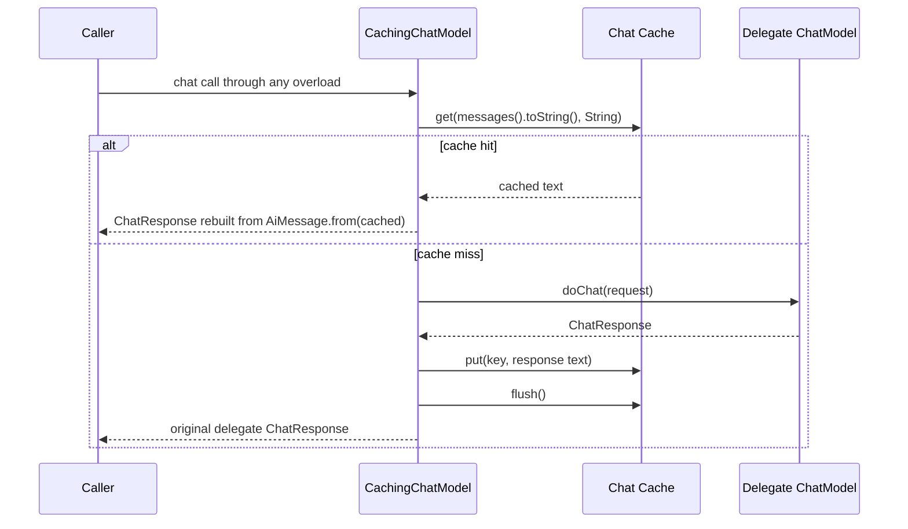
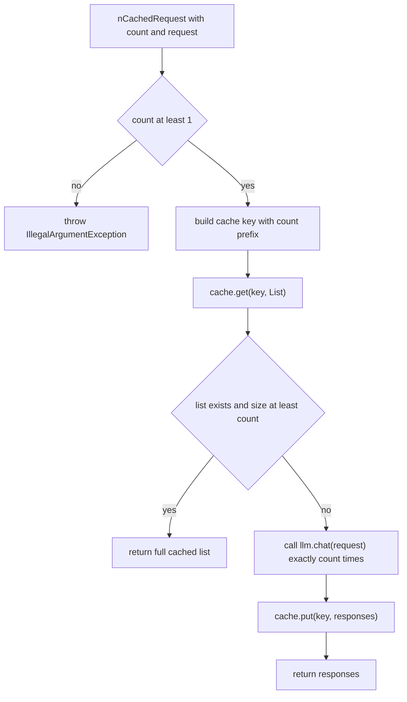

# Cached Chat Requests

There are two ways to cache chat responses, both backed by a `Cache<ChatCacheKey>` obtained
from [CacheManager](../cache/cache-hierarchy.md):

1. **`CachingChatModel`** — a decorator wrapping any `ChatModel` that caches transparently,
   including multi-message chats, without changing call sites.
2. **`ChatModelUtils`** — utility methods for explicit single (`cachedRequest`) or n-fold
   (`nCachedRequest`) cached calls against a raw `ChatModel` and a cache.

Both key on the request content and use the same [cache keys](../cache/cache-keys.md) and
[cache backends](../cache/cache-backends.md).

## Obtaining the chat cache

Callers obtain the cache the same way for both paths (see the [README](../../README.md) example
and [Cache Hierarchy and Manager](../cache/cache-hierarchy.md)):

```java
Cache<ChatCacheKey> cache = CacheManager.getDefaultInstance().getCache(provider, provider.cacheParameters());
```

- `provider.cacheParameters()` returns `new ChatCacheParameter(modelName, seed, temperature)` —
  the model configuration identity from [Chat Models](chat-models.md). With the default
  `LlmConfiguration` temperature of `0.0`, that identifier omits the temperature component.
- `getCache(origin, parameters)` derives the cache name from the origin's class simple name plus
  that parameter identifier, so the cache scope depends on both the origin class and the model
  configuration; repeated requests with equal parameters return the same memoized instance, and
  the same name requested with non-equal parameters throws `IllegalArgumentException`.

## Keying inside the cache layer

Both paths hand plain content strings to the cache; the physical key is derived inside the cache
layer, not by the chat code. `ChatCacheParameter.createCacheKey(content)` builds a
[ChatCacheKey](../cache/cache-keys.md) whose `localKey` is a deterministic UUID of the content
with `\r\n` normalized to `\n` by `KeyGenerator` — that is where line-ending normalization
happens. `LocalCache` addresses entries by `localKey`, while the Redis-based backends address
them by the serialized JSON key; the storage contract is described in
[Cache Core](../cache/cache-core.md).

## CachingChatModel

`CachingChatModel implements ChatModel` wraps a `delegate` `ChatModel` and a
`Cache<ChatCacheKey>`, both required non-null in the constructor. Because every
`ChatModel.chat(...)` overload funnels through the single `doChat(ChatRequest)` default method,
caching is implemented once at that point:

- **Cache key:** `chatRequest.messages().toString()`, the string representation of the message
  list. Line endings are normalized inside the cache key layer (see above).
- **Hit:** returns `ChatResponse.builder().aiMessage(AiMessage.from(cached)).build()` — rebuilt
  from the cached text alone, so token usage and other original response metadata are not
  preserved — and never contacts the delegate.
- **Miss:** forwards to `delegate.doChat`, stores `response.aiMessage().text()` under the same
  key, and calls `cache.flush()` so the response persists immediately (relevant for the file-based
  [LocalCache](../cache/cache-backends.md)); the original delegate response is returned unchanged.
- Non-caching methods (`defaultRequestParameters`, `listeners`, `provider`,
  `supportedCapabilities`) delegate directly to the wrapped model, so the decorator exposes the
  delegate's parameters, listeners, provider, and capabilities.


*Every `ChatModel.chat` overload funnels into `doChat`: hits never reach the delegate, misses write through and flush immediately.*

In the production composition from [Chat Models](chat-models.md), the delegate is the
`LazyChatModel` returned by `ChatModelProvider.createChatModel()`, so the real platform client is
constructed only when the first cache miss reaches it:

```java
ChatModel cached = new CachingChatModel(provider.createChatModel(), cache);
cached.chat(List.of(UserMessage.from("Summarize X"))); // response cached by message content
```

## ChatModelUtils

`ChatModelUtils.nCachedRequest(request, llm, cache, numberOfRequests)` sends `numberOfRequests`
independent `llm.chat(request)` calls, caches the resulting `List<String>` under a composite key,
and returns all responses:

- **Validation:** throws `IllegalArgumentException` when `numberOfRequests < 1`.
- **Cache key:** `numberOfRequests + " results: \n" + request`. The count prefix keeps
  multi-result entries distinct from single-result ones stored through `cachedRequest`.
- **Hit shortcut:** if a cached list holds at least `numberOfRequests` entries, no model calls are
  made and the stored list is returned as-is; the code checks `size() < numberOfRequests`, not
  exact equality, so a longer stored list is also accepted.
- **Miss/recomputation:** otherwise exactly `numberOfRequests` fresh calls are made and the new
  list replaces any stored value; a shorter cached list is never merged or extended.
- **Persistence:** `nCachedRequest` (and therefore `cachedRequest`) never flushes. Durability with
  the file-backed [LocalCache](../cache/cache-backends.md) depends on an explicit `cache.flush()`
  (as in the README example), `CacheManager.flush()`, or `LocalCache`'s auto-flush after more than
  50 modifications — unlike `CachingChatModel`, which flushes after every computed response.

`cachedRequest(request, llm, cache)` delegates to `nCachedRequest(request, llm, cache, 1)` and
returns the first element, so single-result requests share the single-result key space.


*`nCachedRequest` validates the count, separates multi-result from single-result keys by the count prefix, and recomputes the full list whenever the cached one is shorter.*

## Choosing between the two

- Use `CachingChatModel` when caching should be invisible to call sites (e.g. a service that
  already holds a `ChatModel`). Multi-message conversations are cached by message content, and
  every newly computed response is flushed immediately.
- Use `ChatModelUtils` when you want explicit control over n-fold sampling against a raw model,
  or when you obtain a cache separately from the model — accepting that flushing is your
  responsibility.

## Focused tests

- `CachingChatModelTest` — `cachesStringChat`, `cachesMessageListChat`, `cachesVarargsChat`, and
  `cachesRequestChat` (delegate called once per unique input across all overloads), plus
  `cachePersistsAcrossReload` (a new `CachingChatModel` over a reloaded `CacheManager` serves the
  cached value with zero delegate calls). The `RecordingChatModel` helper implements only
  `doChat`, so the tests do not depend on which overload the decorator calls internally; the
  cache is a real `LOCAL` `CacheManager` cache in a `@TempDir` with
  `CACHE_REPLACEMENT_STRATEGY=ERROR`.
- `ChatModelUtilsTest` — `testCachedRequestCaches` (one model call across repeated requests),
  `testNCachedRequest` (exactly 3 calls, then served from cache with a mocked `ChatModel`),
  `testCachePersistence` (flush + manager reload, then `verifyNoInteractions`), and
  `testInvalidCount` (throws for 0).

Validation: `mvn -q test -Dtest=CachingChatModelTest,ChatModelUtilsTest`.
