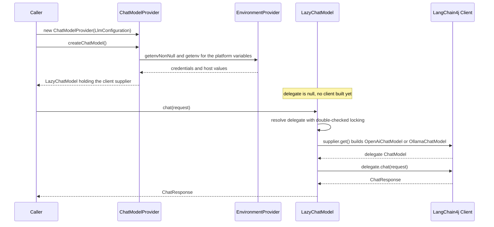
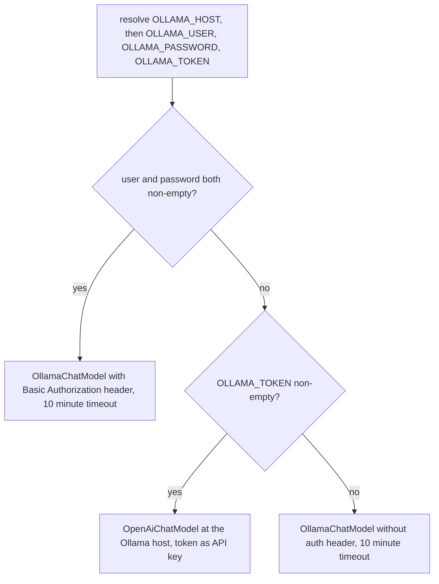

# Chat Models

The chat subsystem's factory turns a framework-neutral `LlmConfiguration` into a LangChain4j
`dev.langchain4j.model.chat.ChatModel`. `ChatModelProvider.createChatModel()` switches over the
`ChatModelPlatform` and **every branch returns a [LazyChatModel](#lazychatmodel)** that builds the
real platform client only on the first `chat(...)` call. The eager/lazy split is deliberate:

- **Eager** — credentials and host URLs are read from the configuration's
  [environment](../concepts/environment-provider.md) while `createChatModel()` runs. A missing
  required variable fails immediately with `IllegalStateException`, before any model object exists.
- **Lazy** — the LangChain4j client (`OpenAiChatModel`, `OllamaChatModel`, ...) is constructed
  inside `LazyChatModel`'s supplier, so invalid keys or unreachable hosts surface at the first chat
  call instead.

In the intended composition the returned model is wrapped in a `CachingChatModel`
(see [Cached Chat Requests](cached-chat.md) and the
[Architecture Overview](../architecture/overview.md)), so the platform client is built only when
the first cache miss reaches it.

## LlmConfiguration

`edu.kit.kastel.mcse.ardoco.llm.chat.LlmConfiguration` is a record with **five** components that
fully determine which chat model is created and how it is cached:

```java
public record LlmConfiguration(ChatModelPlatform platform, String modelName, int seed,
        double temperature, EnvironmentProvider environment)
```

The **`environment` component carries the `EnvironmentProvider` that supplies credentials and host
URLs**, so the configuration itself is all the provider needs — no application-specific
configuration object and no global settings store. Two builders produce it:

- `LlmConfiguration.of(platform, modelName)` — the common case, delegating to the builder with
  default seed and temperature.
- `LlmConfiguration.builder(platform)` — additionally overrides `seed`, `temperature`, and
  `environment`.

Defaults and validation:

- `DEFAULT_SEED = 133742243` and `DEFAULT_TEMPERATURE = 0.0`. The fixed seed and temperature are
  what make cached runs reproducible (see [Cache Keys](../cache/cache-keys.md)).
- The canonical constructor requires non-null `platform`, `modelName`, and `environment`.
- `Builder.build()` throws `IllegalArgumentException` when `modelName` is null or blank
  ("A model name must be set for platform ..."), and defaults the environment to a **new**
  `SystemEnvironment` per configuration when none was set — one instance per configuration, never a
  shared static one (see [Environment and Configuration](../concepts/environment-provider.md)).

## ChatModelPlatform

`ChatModelPlatform` is an enum with exactly the values `OPENAI`, `OLLAMA`, `BLABLADOR`, `DEEPSEEK`,
and `OPENWEBUI`. `fromString(name)` matches enum names case-insensitively and throws
`IllegalArgumentException` for unknown names, which makes it usable for parsing user-supplied
configuration. The model name is deliberately **not** part of the platform; it travels separately
in `LlmConfiguration`.

## ChatModelProvider and createChatModel

The `ChatModelProvider(LlmConfiguration)` constructor only null-checks the configuration and copies
its five fields; it never touches the environment. All environment access happens in the private
factory methods behind `createChatModel()`, which exhaustively switches over the platform:

| Platform | Required env vars | Optional env vars | Client built | Endpoint / timeout |
| --- | --- | --- | --- | --- |
| `OPENAI` | `OPENAI_API_KEY` | `OPENAI_ORGANIZATION_ID` | `OpenAiChatModel` | Default OpenAI endpoint; no explicit timeout |
| `OLLAMA` | `OLLAMA_HOST` | `OLLAMA_USER` + `OLLAMA_PASSWORD`, `OLLAMA_TOKEN` | `OllamaChatModel` or `OpenAiChatModel` (token variant) | Ollama host; 10-minute timeout on the native Ollama client |
| `BLABLADOR` | `BLABLADOR_API_KEY` | — | `OpenAiChatModel` | Hardcoded `https://api.helmholtz-blablador.fz-juelich.de/v1` |
| `DEEPSEEK` | `DEEPSEEK_API_KEY` | — | `OpenAiChatModel` | Hardcoded `https://api.deepseek.com/v1` |
| `OPENWEBUI` | `OPENWEBUI_URL`, `OPENWEBUI_API_KEY` | — | `OpenAiChatModel` | `OPENWEBUI_URL`; 10-minute timeout |

Every client supplier carries the configured `modelName`, `temperature`, and `seed` into the
LangChain4j builder. Blablador, DeepSeek, Open WebUI, and the Ollama token variant all go through
the OpenAI-compatible `OpenAiChatModel`; only OpenAI itself uses the default endpoint without a
custom base URL.

For OpenAI, `OPENAI_ORGANIZATION_ID` is optional and is sent to OpenAI only when set; otherwise it
is omitted from the client. Blablador and DeepSeek hardcode their base URLs, so only an API key is
needed. Open WebUI points the OpenAI-compatible client at `OPENWEBUI_URL` and, together with the
native Ollama client, is the only place an explicit 10-minute timeout is set.

### Eager validation, lazy construction

The factory methods resolve environment variables **before** constructing the `LazyChatModel`:

- Required variables go through `EnvironmentProvider.getenvNonNull`, which throws
  `IllegalStateException` ("environment variable %s is missing") when unset — so
  `createChatModel()` fails fast, per platform, before returning anything.
- Optional variables (`OPENAI_ORGANIZATION_ID`, the three Ollama auth variables) use `getenv`,
  where null is tolerated.

The lambdas handed to `LazyChatModel` capture those values and only run when the first chat call
resolves the delegate. Nothing about the platform client — its builder, connection, or
authentication — is touched at `createChatModel()` time.



*Environment variables are validated eagerly inside `createChatModel()`, while the LangChain4j
client is built by the supplier on the first chat call and then memoized by `LazyChatModel`.*

## The Ollama branch: basic auth, token, or unauthenticated

The Ollama branch is the only one with runtime auth logic. `OLLAMA_HOST` is required and read
eagerly; the three auth variables are optional and read eagerly, but the **choice of client happens
inside the supplier**, i.e. on the first chat call:



*The Ollama supplier builds a basic-authenticated native client, an OpenAI-compatible client at the
same host, or an unauthenticated native client, in that order of precedence.*

- **Basic auth** — when `OLLAMA_USER` and `OLLAMA_PASSWORD` are both non-empty, the native
  `OllamaChatModel` gets a custom header `Authorization: Basic base64(user:password)` and the
  10-minute timeout. Basic auth takes precedence over the token.
- **Token** — otherwise, when `OLLAMA_TOKEN` is non-empty, an OpenAI-compatible `OpenAiChatModel`
  is built against the Ollama host with the token as API key (for endpoints exposed behind the
  host). This variant sets no explicit timeout.
- **Neither** — a plain unauthenticated `OllamaChatModel` with the 10-minute timeout is built.

## LazyChatModel

`LazyChatModel` is a final `ChatModel` implementation that wraps a `Supplier<ChatModel>` (rejected
as null at construction). Its delegate resolution uses double-checked locking:

- The delegate field is `volatile` and starts null; reads take the fast path without locking.
- On first use, a `synchronized` block builds the delegate via the supplier — exactly once, even
  under concurrent access.
- If the supplier throws, the field stays null, so **a failed client construction is not cached**:
  the next chat call retries building the client.

Every `ChatModel` method — the `chat(...)` overloads, the `chatAsync(...)` family,
`defaultRequestParameters`, `listeners`, `provider`, and `supportedCapabilities` — forwards to the
lazily-resolved delegate, so callers cannot distinguish the lazy wrapper from the real client. A
reflection-based test asserts that all non-static `ChatModel` methods are overridden, so a future
interface default method cannot silently bypass the delegation. This is what lets
`ChatModelProvider` hand out a model before anything is connected, and what defers the real client
construction until the first cache miss in the `CachingChatModel` composition
(see [Cached Chat Requests](cached-chat.md)).

## Cache identity: cacheParameters()

`cacheParameters()` is the bridge from the chat subsystem into the cache subsystem:

```java
public ChatCacheParameter cacheParameters() {
    return new ChatCacheParameter(modelName, seed, temperature);
}
```

The model name, seed, and temperature become the chat cache identity. `ChatCacheParameter`
implements `CacheParameter<ChatCacheKey>`; its `createCacheKey(content)` derives a
[ChatCacheKey](../cache/cache-keys.md) from these parameters plus the request content, and its
`parameters()` identifier joins model name and seed, appending the temperature only when it differs
from `0.0` — so the default configuration yields backward-compatible identifiers like
`gpt-4o_133742243`. Callers obtain the matching cache with
`cacheManager.getCache(provider, provider.cacheParameters())`
(see [Cache Hierarchy and Manager](../cache/cache-hierarchy.md)).

## Failure semantics

Failures are tiered by phase:

1. **Configuration time** — `LlmConfiguration.builder(...)...build()` throws
   `IllegalArgumentException` for a missing or blank model name.
2. **Factory time (`createChatModel()`)** — `IllegalStateException` for a missing required
   environment variable, thrown from `getenvNonNull`. This happens per platform before any model
   object is returned.
3. **First chat call** — the supplier runs and builds the client; invalid keys or unreachable hosts
   surface as client errors here. A throwing supplier leaves the delegate null, so the next call
   retries construction.

With an empty environment, `createChatModel()` throws for **every** platform — each supported
platform requires at least one environment variable. Credentials are consulted only in the
injected `EnvironmentProvider`: values present for one platform's variables do not satisfy another
platform's branch, and an ArchUnit rule forbids static `EnvironmentProvider` fields, so no global
environment can reappear (see [Environment and Configuration](../concepts/environment-provider.md)).

## Focused tests

- `ChatModelProviderTest` — `exposesSettings` (getters plus `cacheParameters()` equality),
  `buildsOpenAiModel` (asserts the result is a `LazyChatModel`), `missingCredentialsThrow`
  (iterates all platforms with an empty `MapEnvironment` and expects `IllegalStateException`), and
  `usesInjectedEnvironment` (an Ollama-only environment satisfies Ollama but not OpenAI).
- `ChatConfigurationTest` — `of()` defaults, builder overrides (including `assertSame` on the
  injected environment), the builder's `SystemEnvironment` default, the required-model-name rule
  (null and blank), `fromString` case-insensitivity, and the `ChatCacheParameter` identifier format
  (`gpt-4o_133742243`).
- `LazyChatModelTest` — `lazyInitialization` (supplier not run at construction, exactly once across
  two calls), `nullSupplier` (constructor null check), and `overridesAllChatModelMethods`
  (reflection over `ChatModel`).
- `NoGlobalEnvironmentTest` — ArchUnit rules keeping environments injected rather than static.

## Adding a chat platform

1. Add a constant to `ChatModelPlatform` (name it uppercase — `fromString` matches on `name()`).
2. Add a `case` to `createChatModel()` and a private `createXyzChatModel` factory that reads
   required variables via `getenvNonNull` (so the factory fails fast) and returns a `LazyChatModel`
   wrapping the LangChain4j builder with `modelName`, `temperature`, and `seed`.
3. Extend the tests: `missingCredentialsThrow` iterates every enum value, so the new platform must
   require at least one environment variable for the suite to stay green; add branch-specific
   coverage following `buildsOpenAiModel`, and extend `ChatConfigurationTest` if the platform needs
   parsing or metadata coverage.
