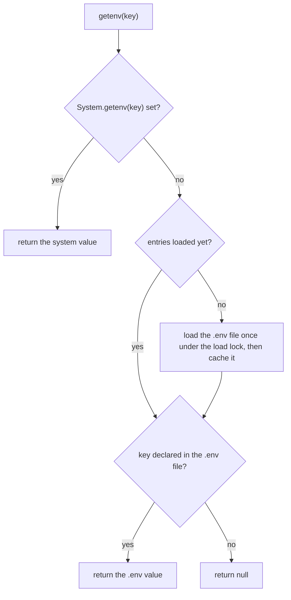
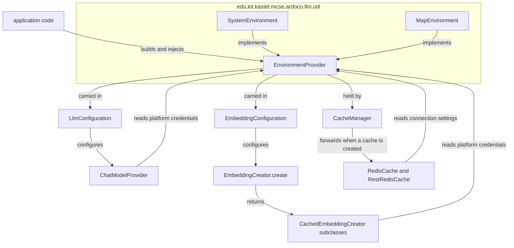

# Environment and Configuration

`llm-access` is framework-neutral: model settings travel as plain configuration records
([Chat Models](../chat/chat-models.md), [Embeddings](../embeddings/embeddings.md)), while
credentials, host URLs, and cache settings are read from an injectable **`EnvironmentProvider`**.
The seam lives in `edu.kit.kastel.mcse.ardoco.llm.util` and has exactly two implementations:

- **`SystemEnvironment`** (the default) — reads system environment variables, falling back to the
  entries of an optional `.env` file.
- **`MapEnvironment`** — serves values from an immutable in-memory map, for tests and
  programmatic setups.

There is no global environment: every consumer receives an `EnvironmentProvider` instance
explicitly, and the configuration records carry one as a component
([Architecture Overview](../architecture/overview.md)). This design replaces the removed legacy
`util.Environment` singleton with its global `overwrite(Path)` API (see
[Relationship to the removed legacy configuration](#relationship-to-the-removed-legacy-configuration)).

## The EnvironmentProvider interface

```java
public interface EnvironmentProvider {
    @Nullable String getenv(String key);

    default String getenvNonNull(String key) {
        String value = getenv(key);
        if (value == null) {
            throw new IllegalStateException("environment variable %s is missing".formatted(key));
        }
        return value;
    }
}
```

- `getenv(key)` returns the value or `null`; where the value comes from is implementation-specific.
- `getenvNonNull(key)` is a `default` method that turns a missing variable into an immediate
  `IllegalStateException` ("environment variable %s is missing"). Implementations may override it
  to add a hint on where to set the variable — `SystemEnvironment` does, `MapEnvironment` keeps
  the generic message.

Consumers use `getenvNonNull` for required credentials (so they fail fast) and `getenv` for
optional ones.

## SystemEnvironment: system variables with a lazy .env fallback

`SystemEnvironment` resolves a lookup in a fixed precedence:

1. The **system environment variable** (`System.getenv(key)`), if set.
2. The entry from the **`.env` file**, if the file declares it.
3. Otherwise `null`.

A `.env` entry is therefore used only when that variable is not already exported. The file is
read **lazily**: the path is resolved on construction, but the file is parsed on the first lookup
that is not answered by a system variable (or on the first `equals`/`hashCode` comparison, which
needs the entries), and the parsed entries are then kept for the lifetime of the instance.
Consequently creating an instance is cheap, and a missing or malformed file only matters once a
value is actually requested — a malformed file surfaces as a dotenv `DotenvException` on those
lookups, never at construction. The load is guarded by double-checked locking over a `volatile`
map (concurrent first calls load the file exactly once); a load that fails leaves the cache
empty, so the next call tries again. Only entries declared in the file itself
(`Dotenv.Filter.DECLARED_IN_ENV_FILE`) are collected, into an unmodifiable map. The dotenv
directory argument carries a trailing separator so dotenv-java's directory-name stripping cannot
corrupt a parent directory whose own name ends in `.env` (e.g. `conf.env`).



*System variables win without ever touching the file; the `.env` file is loaded at most once per
instance and only when a lookup actually needs it.*

Two constructors pick the file:

- `new SystemEnvironment()` — the `.env` file of the current working directory
  (`Path.of(".env")`, resolved to an absolute normalized path). If it is absent, a debug message
  is logged and only system variables are used.
- `new SystemEnvironment(Path dotenvFile)` — an explicitly given file. If it is absent, a
  **warning** is logged when the file is first needed, and again only system variables are used.

Instances are thread-safe and independent of each other; there is **no shared global
environment**. Equality is defined over the `.env` file path plus the entries loaded from it —
system variables are deliberately not compared, because they are shared by all instances of a
process. The comparison forces each side to load its file if it has not yet, so instances created
before and after a change to the file may compare unequal. `toString()` exposes only the file
path (`SystemEnvironment[dotenvFile=…]`), never values. The overridden `getenvNonNull` names both
places to set a variable: "environment variable %s is missing, set it in the system environment
or in '<dotenvFile>'".

## MapEnvironment: in-memory and secret-safe

`MapEnvironment` is backed by an immutable copy of the caller's map:

- The constructor performs `Map.copyOf(values)`, so later changes to the source map have no
  effect; a null map, key, or value is rejected with `NullPointerException`.
- Keys absent from the map are reported as unset — **there is no fallback to the system
  environment** (even `PATH` reads as `null`), which makes environments fully deterministic under
  test.
- `equals`/`hashCode` compare the value maps, so two environments with the same entries are
  interchangeable.
- `toString()` returns the variable **names only** (sorted, e.g.
  `MapEnvironment[OPENAI_API_KEY, OLLAMA_HOST]`), deliberately omitting values because they
  typically contain secrets such as API keys. Nothing an environment carries can leak into a log
  through its own description; `SystemEnvironment` applies the same rule to its values.

`getenvNonNull` keeps the interface's generic message — a map environment has nothing to do with
`.env` files, so the message names the key but never a file.

## How the environment reaches the consumers



*One injected `EnvironmentProvider` (or two different ones) supplies the chat/embedding platform
credentials via the configuration records and the cache settings via the `CacheManager`, which
forwards it to the Redis-based backends.*

There are two distinct consumption paths, and they may use different environments:

- **Model credentials and hosts** come from the `environment` component of `LlmConfiguration` and
  `EmbeddingConfiguration`. `ChatModelProvider` reads them inside `createChatModel()`
  (fail-fast for required variables); the embedding creators read them when the creator is
  constructed.
- **Cache settings** come from the `EnvironmentProvider` each `CacheManager` was created with.
  `CACHE_HIERARCHY` and `CACHE_REPLACEMENT_STRATEGY` are read once at construction; the Redis
  connection settings are read from the same environment when the first cache is requested from
  the manager (see [Cache Hierarchy and Manager](../cache/cache-hierarchy.md) and
  [Cache Backends](../cache/cache-backends.md)).

A single `MapEnvironment` can serve both paths, as the README's programmatic-setup example shows
(`new MapEnvironment(Map.of("OPENAI_API_KEY", apiKey, "CACHE_HIERARCHY", "LOCAL"))` handed to a
`CacheManager` and to both configuration builders).

### Builder and constructor defaults

Every convenience entry point defaults to a **new `SystemEnvironment` per object** — never to a
shared static instance:

- `LlmConfiguration.builder(...).build()` and `EmbeddingConfiguration.builder(...).build()` call
  `new SystemEnvironment()` when `.environment(...)` was not set; the injected instance is stored
  as-is (`assertSame`-verified in tests).
- `new CacheManager(Path)` and the single-argument `CacheManager.setCacheDir(String)` likewise
  construct a fresh `SystemEnvironment`.

Because the `.env` file is read lazily, these per-object defaults stay cheap; each object simply
owns its own environment.

## Environment variable reference

Variables are read from the environment of the component listed below; chat and embedding
variables from the configuration's environment, cache variables from the `CacheManager`'s.

| Variable | Read by | Required | Unset behavior |
| --- | --- | --- | --- |
| `OPENAI_API_KEY` | chat and embeddings (OpenAI) | yes | `IllegalStateException` from `getenvNonNull` |
| `OPENAI_ORGANIZATION_ID` | chat and embeddings (OpenAI) | no | omitted from the client |
| `OLLAMA_HOST` | chat (Ollama) | yes | `IllegalStateException` |
| `OLLAMA_USER` / `OLLAMA_PASSWORD` | chat (Ollama) | no | basic auth header not sent |
| `OLLAMA_TOKEN` | chat (Ollama) | no | OpenAI-compatible token variant unused |
| `BLABLADOR_API_KEY` | chat (Blablador) | yes | `IllegalStateException` |
| `DEEPSEEK_API_KEY` | chat (DeepSeek) | yes | `IllegalStateException` |
| `OPENWEBUI_URL` / `OPENWEBUI_API_KEY` | chat and embeddings (Open WebUI) | yes | `IllegalStateException` |
| `OLLAMA_EMBEDDING_HOST` | embeddings (Ollama) | yes | `IllegalStateException` |
| `OLLAMA_EMBEDDING_USER` / `OLLAMA_EMBEDDING_PASSWORD` | embeddings (Ollama) | no | basic auth header not sent |
| `CACHE_HIERARCHY` | `CacheManager` | no | `LOCAL` |
| `CACHE_REPLACEMENT_STRATEGY` | `CacheManager` (layered caches) | no | `NONE` |
| `REDIS_URL` | `RedisCache` | no | `redis://localhost:6379` |
| `REST_REDIS_URI` | `RestRedisCache` | no | `http://localhost:8080` |
| `REST_REDIS_USERNAME` / `REST_REDIS_PASSWORD` | `RestRedisCache` | no | not sent (Basic auth only when set) |

Notes:

- The **cache directory is not an environment variable**. It is set in code via
  `CacheManager.setCacheDir(...)` or the `CacheManager(Path)` constructor; pick where that value
  comes from in your own runner (e.g. a `LLM_CACHE_DIR` variable you read and pass in).
- The ONNX embedding platform reads no environment variables — its model and tokenizer paths come
  from `EmbeddingConfiguration.onnx(...)`.
- [`sample.env`](../../sample.env) is the template: a commented skeleton of all variables
  above, with the cache section pointing at the README's deployment instructions.
- Per-variable detail: [Chat Models](../chat/chat-models.md) and
  [Embeddings](../embeddings/embeddings.md) for the platform variables,
  [Cache Hierarchy and Manager](../cache/cache-hierarchy.md) and
  [Cache Backends](../cache/cache-backends.md) for the cache variables.

## The no-global-environment invariant

Environments are values, not singletons: an `EnvironmentProvider` is always passed as a
constructor parameter or held in an instance field, and the library uses the `CacheManager` it is
given instead of falling back to a default instance. Two ArchUnit rules in
`NoGlobalEnvironmentTest` (which analyzes all non-test classes under
`edu.kit.kastel.mcse.ardoco.llm`) make this enforced rather than merely conventional:

1. **`noStaticEnvironmentFields`** — no static field may have a type assignable to
   `EnvironmentProvider` ("environments must be injected, not shared globally"). This forbids
   reintroducing a singleton like the removed legacy `Environment` class.
2. **`defaultCacheManagerOnlyInConvenienceOverload`** — `CacheManager.getDefaultInstance()` may
   only be called from `EmbeddingCreator.create(EmbeddingConfiguration)`; everywhere else the
   cache manager — and with it the cache environment — must be injected.

The one sanctioned call site is the convenience overload `EmbeddingCreator.create(configuration)`,
which delegates to `create(configuration, CacheManager.getDefaultInstance())` and short-circuits
to a `MockEmbeddingCreator` first when the platform is `MOCK`, so a mock creator can be built
without any cache setup. Creating an environment-less `LlmConfiguration`, `EmbeddingConfiguration`,
or `CacheManager` is not a violation precisely because their defaults are fresh
`SystemEnvironment` instances per object. See
[Testing Strategy](../testing/strategy.md) for how the rules are enforced in the build.

## Focused tests

- `SystemEnvironmentTest` (uses a `@TempDir` `.env` file) — values are read from the given file;
  lookups fall back to the system environment for keys absent from it (asserting equality with
  `System.getenv("PATH")`); unknown keys return `null`; system variables win over a `.env` entry
  for the same key while other keys still load; the file is read on the first lookup and not
  re-read afterwards (the test rewrites the file and observes the stale value); a malformed file
  fails only the lookups that need it (`DotenvException`), never construction; a missing explicit
  file degrades to system-only lookups; instances on different files are independent and unequal;
  instances on the same file are equal, hash-equal, and hide values in `toString()`; instances
  that loaded different versions of the same file are unequal; a `.env` inside a directory named
  `conf.env` loads; the default constructor targets the working directory without reading
  anything.
- `MapEnvironmentTest` — mapped values are returned and unknown keys yield `null` (including
  `PATH`, pinning the no-system-fallback rule); `getenvNonNull` throws a message naming the key
  but not `.env`; later changes to the source map do not affect the environment (defensive copy);
  `toString()` lists keys but never values (`sk-very-secret`, the Ollama host are absent);
  environments with the same entries are equal and hash-equal.
- `NoGlobalEnvironmentTest` — the two ArchUnit rules described above.

## Relationship to the removed legacy configuration

An earlier configuration page described a static `util.Environment` utility backed by dotenv with
`.env`-first precedence and an `overwrite(Path)` method used by tests to swap the configuration.
That class no longer exists; the seam is now the `EnvironmentProvider` interface with per-instance
implementations:

| Legacy (`util.Environment`) | Current |
| --- | --- |
| Static singleton, one process-wide configuration | An `EnvironmentProvider` value injected per configuration/manager |
| `Environment.getenv(key)` (`.env` first, then system) | `environment.getenv(key)` on an injected `SystemEnvironment` (system first, then its `.env`) |
| `Environment.overwrite(Path)` to repoint the singleton | `new SystemEnvironment(path)` injected where needed |
| Tests mutating the global environment | Tests inject a `MapEnvironment`, so they do not depend on the developer's system environment or `.env` file |

`KeyGenerator` and `Futures`, which the removed page also documented, are unchanged members of the
same package; they concern cache-key derivation and parallel embedding futures rather than
environment handling, so they are covered with the subsystems that use them
([Cache Keys](../cache/cache-keys.md), [Embeddings](../embeddings/embeddings.md)).
