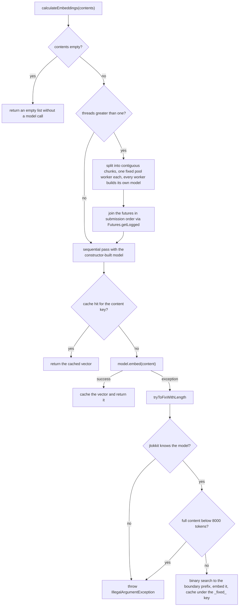

# Embeddings

The embedding subsystem turns text into `float[]` vectors for similarity matching. Application
code builds an `EmbeddingConfiguration`, hands it to the static factory `EmbeddingCreator.create`,
and calls `calculateEmbedding` or `calculateEmbeddings` on the returned creator. Every real
platform routes through `CachedEmbeddingCreator`, which caches each computed vector in a
`Cache<EmbeddingCacheKey>` obtained from the [CacheManager](../cache/cache-hierarchy.md) it was
constructed with; only the `MOCK` platform skips caching entirely. The key types behind that cache
are covered in [Cache Keys](../cache/cache-keys.md), credentials and host URLs come from the
[EnvironmentProvider](../concepts/environment-provider.md) carried by the configuration, and the
chat-side counterpart of this machinery is described in
[Cached Chat](../chat/cached-chat.md).

```java
CacheManager.setCacheDir("cache"); // required before the single-argument factory for caching platforms
EmbeddingCreator creator = EmbeddingCreator.create(EmbeddingConfiguration.of(EmbeddingPlatform.OPENAI, "text-embedding-3-large"));

float[] vector = creator.calculateEmbedding("some text");
var vectors = creator.calculateEmbeddings(List.of("a", "b", "c"));
```

## EmbeddingConfiguration and EmbeddingPlatform

`EmbeddingConfiguration` is a framework-neutral record
`(EmbeddingPlatform platform, String modelName, @Nullable String pathToModel, @Nullable String pathToTokenizer, EnvironmentProvider environment)`.
The two path components are only consumed by the ONNX platform; the canonical constructor rejects
`null` for `platform`, `modelName`, and `environment`. Three factories cover the common cases:

- `of(platform, modelName)` — the simple form, built on the builder.
- `onnx(model, pathToModel, pathToTokenizer)` — an ONNX configuration with the two local file paths.
- `builder(platform)` — full control, including `pathToModel`, `pathToTokenizer`, and `environment`.

The builder validates at `build()` time: a missing or blank model name throws
`IllegalArgumentException` for every platform except `MOCK`, which ignores the model entirely and
falls back to the name `"mock"`. When no environment is set, `build()` creates a new
`SystemEnvironment`, so an unset configuration still reads the process environment and the
optional `.env` file.

`EmbeddingPlatform` is the enum `OLLAMA`, `OPENAI`, `ONNX`, `OPENWEBUI`, `MOCK`. Its static
`fromString` resolves names case-insensitively and throws `IllegalArgumentException` for unknown
names — it is the parse point for string-driven configurations.

## The EmbeddingCreator factory

`EmbeddingCreator` is the abstract base class: `calculateEmbedding(String)` delegates to
`calculateEmbeddings(List.of(content)).getFirst()`, and `calculateEmbeddings(List<String>)` is the
single abstract operation. The static factory `create(EmbeddingConfiguration, CacheManager)`
dispatches on the configuration's `platform()`:

| Platform | Creator | Threads | Required inputs |
| --- | --- | --- | --- |
| `OLLAMA` | `OllamaEmbeddingCreator` | 1 | `OLLAMA_EMBEDDING_HOST`; optional `OLLAMA_EMBEDDING_USER` / `OLLAMA_EMBEDDING_PASSWORD` |
| `OPENAI` | `OpenAiEmbeddingCreator` | 40 | `OPENAI_API_KEY`; optional `OPENAI_ORGANIZATION_ID` |
| `ONNX` | `OnnxEmbeddingCreator` | 1 | non-null `pathToModel` and `pathToTokenizer` (checked with `requireNonNull` here, existence checked by the creator) |
| `OPENWEBUI` | `OpenWebUiEmbeddingCreator` | 1 | `OPENWEBUI_URL` and `OPENWEBUI_API_KEY` |
| `MOCK` | `MockEmbeddingCreator` | — | none; the cache manager is ignored |

The caching creators receive the `CacheManager` as a constructor argument — they never resolve the
default instance themselves. The cache settings therefore come from the manager (hierarchy,
replacement strategy, directory) while the model credentials come from the configuration's
environment; `EmbeddingCreator.create` requires both arguments to be non-null.

The convenience overload `create(EmbeddingConfiguration)` short-circuits `MOCK` **before** touching
any global state and otherwise delegates to the two-argument factory with
`CacheManager.getDefaultInstance()`. That resolution is the single call site the
`NoGlobalEnvironmentTest.defaultCacheManagerOnlyInConvenienceOverload` ArchUnit rule permits for
`getDefaultInstance()`, so the rest of the library cannot bypass dependency injection. The overload
throws `IllegalStateException` when a caching platform is configured and the default instance has
not been set up via `CacheManager.setCacheDir` (see
[Cache Hierarchy and Manager](../cache/cache-hierarchy.md)); with `MOCK`, no cache directory is
needed.

## Platform creators

All four real creators extend `CachedEmbeddingCreator` and implement only
`createEmbeddingModel(String model, String... params)`, reading their credentials from the
protected `environment()` accessor:

- **OpenAI** (`OpenAiEmbeddingCreator`) — the only multi-threaded creator: it passes
  `THREADS = 40` to the base constructor. It requires `OPENAI_API_KEY` (via `getenvNonNull`, so a
  missing key fails fast with `IllegalStateException`), sends `OPENAI_ORGANIZATION_ID` only when
  it is set, and builds the LangChain4j `OpenAiEmbeddingModel` with `maxRetries(0)` so failures
  surface immediately instead of being retried inside the client.
- **Ollama** (`OllamaEmbeddingCreator`) — single-threaded. It requires `OLLAMA_EMBEDDING_HOST` and,
  when both `OLLAMA_EMBEDDING_USER` and `OLLAMA_EMBEDDING_PASSWORD` are set and non-empty, sends a
  `Basic` `Authorization` header. The request timeout is five minutes.
- **ONNX** (`OnnxEmbeddingCreator`) — single-threaded and fully local. The model and tokenizer file
  paths travel as `params`; the creator checks that both files exist and throws
  `IllegalStateException` ("Model or Tokenizer file does not exist") otherwise, then builds an
  `OnnxEmbeddingModel` with `PoolingMode.MEAN`. The environment is currently not read by this
  backend, although the base class still requires one.
- **Open WebUI** (`OpenWebUiEmbeddingCreator`) — single-threaded. It requires `OPENWEBUI_URL` and
  `OPENWEBUI_API_KEY` and reuses the OpenAI client builder pointed at the server URL (a
  five-minute timeout applies), speaking the OpenAI-compatible protocol.
- **Mock** (`MockEmbeddingCreator`) — extends `EmbeddingCreator` directly, not the caching base
  class. It performs no caching, reads no environment, and maps every input to a zero vector of
  length 1 (`new float[] { 0 }`), which keeps embedding-dependent pipelines runnable in tests.

## CachedEmbeddingCreator

`CachedEmbeddingCreator` is an abstract, package-private template-method base: the dispatch in
`calculateEmbeddings` is `final`, so subclasses supply only model construction. Its constructor
runs in a deliberate order:

1. The `EnvironmentProvider` is validated and assigned **first**, because `createEmbeddingModel`
   (called below) is overridden by subclasses and reads the environment during the super
   constructor call.
2. The `CacheManager` is validated, an `EmbeddingCacheParameter(model)` is built, and the
   embedding cache is obtained from the injected manager via `getCache(this, parameter)`. The
   manager derives the cache name from the concrete creator class and the model name
   (`<SimpleName>_<modelName>`, colons doubled), so each creator/model pair persists in its own
   cache file inside the manager's directory.
3. The primary `EmbeddingModel` is built eagerly through the abstract `createEmbeddingModel` and
   must be non-null.
4. The thread count is clamped to at least 1.

A consequence of step 1 and 3: `createEmbeddingModel` runs before any subclass constructor body,
so platform creators must not depend on their own instance fields inside it — all configuration
reaches the method through the constructor arguments and `params`.

### Execution path

`calculateEmbeddings(List<String>)` is `final` and dispatches:

- **Empty input** returns an empty list without touching the model or the cache.
- **`threads == 1`** processes the contents sequentially with the constructor-built model.
- **`threads > 1`** splits the input into contiguous chunks processed by a fixed thread pool of
  `min(threads, contents.size())` workers. Each worker constructs its **own** `EmbeddingModel` via
  `createEmbeddingModel` with the stored model name and `params` (the constructor-built model is
  used only on the sequential path), and the last worker absorbs the remainder when the size does
  not divide evenly. The executor is shut down and awaited with a one-day
  `awaitTermination`; an interrupt re-interrupts the thread. Futures are then joined with
  `Futures.getLogged` and flattened **in submission order**, which preserves the input order of
  the results regardless of completion order.

Per content, `calculateFinalEmbedding` first asks the cache (`cache.get(content, float[].class)`);
a hit returns the stored vector without a model call. On a miss it calls
`embeddingModel.embed(content).content().vector()`, stores the vector under the content key, and
returns it. Any exception during embedding is logged (the log line references
`KeyGenerator.generateKey(content)`, the same UUID the file cache stores the entry under) and
handed to the long-text fallback below.



*Execution path through `CachedEmbeddingCreator`: empty-input short-circuit, sequential versus
parallel splitting, cache lookup, and the long-text recovery fallback.*

### Long-text recovery

When an embed call fails, the fallback `tryToFixWithLength` assumes the content exceeded the
model's token limit. `MAX_TOKEN_LENGTH = 8000` is deliberately conservative — the source comment
notes that 8192 is the ada limit — so a prefix truncated at this threshold still embeds
successfully on the real models. The recovery proceeds as follows:

1. **Fixed-key lookup.** The candidate key is the original content key's `localKey` (a
   `KeyGenerator` UUID) suffixed with `_fixed_8000`, built through the deprecated
   `EmbeddingCacheKey.ofRaw` with the JSON content marker `(FIXED::8000): <content>`. The lookup
   and the later store go through the deprecated `getViaInternalKey`/`putViaInternalKey` cache
   methods — the one sanctioned embedding use of that internal-key path, kept for backwards
   compatibility with existing caches. A hit returns the truncated embedding immediately.
2. **Failure attribution.** The jtokkit encoding registry resolves the configured model name. If
   the model is unknown to jtokkit, or the full content counts **fewer** than `MAX_TOKEN_LENGTH`
   tokens, the original failure was not a length problem and the method throws
   `IllegalArgumentException` ("Don't know how to handle previous exception") — the caller sees
   the recovery failure, not a silently wrong embedding.
3. **Binary-search truncation.** Otherwise a binary search over character offsets advances to the
   first prefix that reaches `MAX_TOKEN_LENGTH` tokens. That boundary prefix is embedded, and the
   resulting vector is stored under the fixed key so repeat requests for the same long text are
   served from the cache.

The truncated vector is stored **only** under the `_fixed_` key; the original content key never
receives a vector, so the untruncated text can never be answered with the wrong embedding.

### Futures joining

`Futures.getLogged` resolves a worker future: `InterruptedException` is logged, the interrupt flag
is restored, and an `IllegalStateException` is thrown; any other failure is logged and rethrown as
`IllegalStateException`. This is what converts a failed worker (for example an exhausted recovery
in `tryToFixWithLength`) into a hard failure of the whole `calculateEmbeddings` call instead of a
silently missing vector.

## Focused tests

`CachedEmbeddingCreatorTest` drives a recording subclass whose model is a Mockito stub that counts
`embed` calls and derives a deterministic vector from the first character:

- `cachesEmbeddings` — the second call for the same content hits the cache (one model call total).
- `preservesOrder` — results match the input order.
- `emptyInput` — empty input produces no model call.
- `persistsAcrossReload` — after `flush`, a freshly constructed `CacheManager` serves the value
  from disk with zero model calls.
- `parallelPathForwardsParameters` — the parallel path builds per-thread models that all receive
  the forwarded `params`.
- `injectedEnvironmentIsUsedDuringConstruction` — `createEmbeddingModel` observes the environment
  injected into the constructor.
- `createUsesConfiguredEnvironment` / `createPassesEnvironmentToOpenWebUi` — `EmbeddingCreator.create`
  fails fast when a required credential is missing from the configured environment and otherwise
  instantiates the expected creator.
- `usesInjectedCacheManager` / `createUsesInjectedCacheManager` — the cache file lands in the
  injected manager's directory, and a manager configured for an unreachable Redis propagates the
  backend failure out of `create`.

`EmbeddingConfigurationTest` covers `of`/`onnx`/builder construction, the non-blank model name
requirement (with the MOCK exception), the `SystemEnvironment` default, case-insensitive
`fromString`, the mock creator's zero vectors, and the `NullPointerException` when an ONNX
configuration lacks its file paths. Run them with
`mvn -q test -Dtest=CachedEmbeddingCreatorTest,EmbeddingConfigurationTest`; the environment and
cache-manager injection rules are enforced by the ArchUnit tests described in
[Testing Strategy](../testing/strategy.md).

## Adding an embedding platform

1. Add a constant to `EmbeddingPlatform`.
2. Create a subclass of `CachedEmbeddingCreator` (or of `EmbeddingCreator` for a non-caching one)
   in the same package — the caching base class is package-private — implementing
   `createEmbeddingModel`. Pass the thread count, the `EnvironmentProvider`, and the `CacheManager`
   through to the super constructor, and hand extra builder inputs (such as file paths) over as
   `params`. Remember that `createEmbeddingModel` executes inside the super constructor, before
   subclass fields exist.
3. Add a `case` to `EmbeddingCreator.create` and read credentials from the injected environment.
4. Extend `EmbeddingConfigurationTest` and `CachedEmbeddingCreatorTest` (the latter's
   `RecordingEmbeddingCreator` shows the stub-model pattern).

The embedding subsystem sits next to the chat subsystem in the layering described in
[Architecture Overview](../architecture/overview.md): creators depend on the cache package and on
util, never the other way around.
