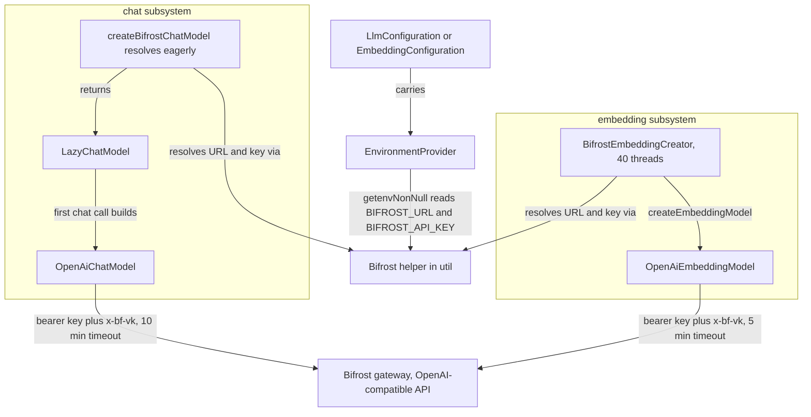

# Bifrost Gateway Integration

Bifrost is an LLM gateway that exposes an OpenAI-compatible API (see the platform table in the
[`README`](../../README.md)). Inside llm-access it appears exactly once on each side of the house:
as `ChatModelPlatform.BIFROST` in the chat subsystem and as `EmbeddingPlatform.BIFROST` in the
embedding subsystem. Three things distinguish it from every other platform:

1. **One shared settings contract.** Both consumers resolve the same two required environment
   variables, `BIFROST_API_KEY` and `BIFROST_URL`, through the *same* helper code — a small final
   utility class in the util layer, `edu.kit.kastel.mcse.ardoco.llm.util.Bifrost` — instead of
   each subsystem reading the variables in its own factory. This is the only setting block shared
   verbatim across the two consumer subsystems (see
   [Architecture Overview](../architecture/overview.md)).
2. **Provider-prefixed model names.** Models are addressed as `<provider>/<model>` — for example
   `openai/gpt-4o-mini` for chat and `openai/text-embedding-3-small` for embeddings — and the full
   prefixed string travels through the client builder, the cache identity, and (on the embedding
   side) a tokenizer-lookup fallback.
3. **A live smoke test with its own CI workflow.** `BifrostIntegrationTest` talks to a real
   gateway and is silently skipped without credentials; a dedicated GitHub Actions workflow,
   [`.github/workflows/bifrost.yml`](../../.github/workflows/bifrost.yml), is the only CI context
   in which the library actually calls one.

The gateway semantics themselves (routing, virtual-key management, deployment) live on the Bifrost
side; this page documents how the library integrates with them. The surrounding platform machinery
— the chat factory table, the embedding creator table, and the caching layers — is covered in
[Chat Models](../chat/chat-models.md) and [Embeddings](../embeddings/embeddings.md).



*Both subsystems resolve the same required `BIFROST_URL`/`BIFROST_API_KEY` pair through the shared
util helper and build OpenAI-compatible LangChain4j clients that carry the virtual key as bearer
token and `x-bf-vk` header; the chat client waits 10 minutes and is built lazily, the embedding
model 5 minutes across 40 worker threads.*

## The shared contract: `util/Bifrost`

[`Bifrost.java`](../../src/main/java/edu/kit/kastel/mcse/ardoco/llm/util/Bifrost.java) is a small,
stateless utility class — the entire integration surface between the library and the gateway:

```java
public final class Bifrost {
    public static final String API_KEY_VARIABLE   = "BIFROST_API_KEY";
    public static final String URL_VARIABLE       = "BIFROST_URL";
    public static final String VIRTUAL_KEY_HEADER = "x-bf-vk";

    public static String baseUrl(EnvironmentProvider environment)  // getenvNonNull(URL_VARIABLE)
    public static String apiKey(EnvironmentProvider environment)   // getenvNonNull(API_KEY_VARIABLE)
    public static Map<String, String> headers(String apiKey)       // Map.of("x-bf-vk", apiKey)
}
```

The contract has three properties:

- **Both variables are required and resolved through `getenvNonNull`.** `Bifrost.baseUrl(...)`
  and `Bifrost.apiKey(...)` delegate to
  [`EnvironmentProvider.getenvNonNull`](../../src/main/java/edu/kit/kastel/mcse/ardoco/llm/util/EnvironmentProvider.java),
  which throws `IllegalStateException` ("environment variable %s is missing") when the variable is
  unset — so whichever consumer runs first fails fast, against whatever `EnvironmentProvider` its
  configuration carries (`SystemEnvironment` in production, `MapEnvironment` in tests; see
  [Environment and Configuration](../concepts/environment-provider.md)).
- **The virtual key is dual-purpose authentication material.** `headers(apiKey)` returns the
  single-entry map `{"x-bf-vk": apiKey}` — the header through which Bifrost accepts the virtual key
  *in addition to* the OpenAI bearer token. Every consumer sends the same value both ways: as the
  LangChain4j client's `apiKey` (bearer) and as the `x-bf-vk` custom header.
- **There are no optional Bifrost variables.** The helper performs exactly two lookups, both
  non-null-required. Everything else about a Bifrost chat call — model name, seed, temperature —
  comes from `LlmConfiguration`, not the environment.

This shared resolution is what makes Bifrost structurally unique. OpenAI and Open WebUI also reuse
the *same variable names* across chat and embeddings (`OPENAI_API_KEY`;
`OPENWEBUI_URL`/`OPENWEBUI_API_KEY`), but each subsystem reads them in its own factory code.
Bifrost is the only platform whose resolution logic itself is shared: one class, read by
`ChatModelProvider.createBifrostChatModel()` and `BifrostEmbeddingCreator.createEmbeddingModel`
alike, so the two sides cannot drift apart.

## The chat consumer: `createBifrostChatModel`

The `BIFROST` case of [`ChatModelProvider.createChatModel()`](../../src/main/java/edu/kit/kastel/mcse/ardoco/llm/chat/ChatModelProvider.java)
behaves like the other eager-validation platforms, with one twist — the credential lookup goes
through the helper:

1. `Bifrost.baseUrl(environment)` and `Bifrost.apiKey(environment)` resolve the URL and key
   **eagerly**, inside `createChatModel()`. A missing variable aborts the factory call with
   `IllegalStateException` before anything is returned.
2. The resolved values are captured by a supplier handed to a `LazyChatModel`, so nothing about the
   platform client — builder, connection, authentication — is touched until the first chat call
   resolves the delegate.
3. On first use, the supplier builds an `OpenAiChatModel` pointed at `BIFROST_URL` with the
   configured model name, the key as bearer token, `Bifrost.headers(apiKey)` as custom headers, the
   configured `temperature` and `seed`, and an explicit **10-minute timeout**.

`ChatModelProviderTest.buildsBifrostModel` asserts that the result is a `LazyChatModel` when both
variables are present, and `bifrostRequiresKeyAndUrl` asserts the fail-fast `IllegalStateException`
when only the key or only the URL is set.

The full platform comparison (endpoint, timeouts, and the other five chat platforms) lives in
[Chat Models](../chat/chat-models.md); only the Bifrost-relevant differences are repeated here.

## The embedding consumer: `BifrostEmbeddingCreator`

[`BifrostEmbeddingCreator`](../../src/main/java/edu/kit/kastel/mcse/ardoco/llm/embedding/BifrostEmbeddingCreator.java)
extends the caching base class and implements only `createEmbeddingModel`:

- **40 threads.** The constructor passes `THREADS = 40` to `CachedEmbeddingCreator`, matching
  `OpenAiEmbeddingCreator` — the two multi-threaded creators of the embedding subsystem. All other
  creators run single-threaded (see [Embeddings](../embeddings/embeddings.md) for the full table).
- **`OpenAiEmbeddingModel` at the gateway.** `createEmbeddingModel` resolves the key and URL via
  the same `Bifrost` helper, then builds an `OpenAiEmbeddingModel` with the key as bearer token,
  the `x-bf-vk` custom header, the configured model name, and an explicit **5-minute timeout**.
  Unlike the OpenAI creator it sets no explicit `maxRetries` — the OpenAI creator pins
  `maxRetries(0)` so failures surface immediately instead of being retried inside the client.
- **No extra parameters.** `params` is accepted and ignored — unlike ONNX, where file paths travel
  through it.

`EmbeddingCreator.create` dispatches the `BIFROST` case to this creator, handing over the model
name, the configuration's environment, and the caller's `CacheManager`.

### When the settings are read

The resolution timing differs subtly from the chat side, and it matters for failure modes:

- `CachedEmbeddingCreator`'s **constructor** invokes `createEmbeddingModel`, so the two
  `getenvNonNull` reads happen when the creator is constructed — a missing variable fails the
  `EmbeddingCreator.create(...)` call itself.
- The parallel path of `calculateEmbeddings` builds **one model instance per worker thread**, each
  via another `createEmbeddingModel` call — so a 40-worker batch re-resolves the pair through the
  same helper up to 40 times. The reads are cheap (an environment lookup, not a network call), and
  every worker ends up with an identically configured `OpenAiEmbeddingModel`.

`CachedEmbeddingCreatorTest.createBuildsBifrostCreator` pins this contract: `EmbeddingCreator.create`
throws `IllegalStateException` with no variables, throws again with only the key, and builds a
`BifrostEmbeddingCreator` once both key and URL are present.

### Chat vs. embeddings at a glance

| | Chat — `createBifrostChatModel` | Embeddings — `BifrostEmbeddingCreator` |
| --- | --- | --- |
| LangChain4j client | `OpenAiChatModel` | `OpenAiEmbeddingModel` |
| Endpoint | `BIFROST_URL` | `BIFROST_URL` |
| Authentication | virtual key as bearer token **and** `x-bf-vk` header | same |
| Timeout | 10 minutes | 5 minutes |
| Parallelism | — (one lazy client) | 40 threads, one model instance per worker |
| Client retries | LangChain4j builder defaults (no explicit cap) | no explicit cap (unlike `OpenAiEmbeddingCreator`'s `maxRetries(0)`) |
| Settings resolved | eagerly in `createChatModel()`; client built lazily on first chat call | during creator construction; re-resolved per worker thread |
| Model settings carried | model name, `temperature`, `seed` | model name |
| Example model name | `openai/gpt-4o-mini` | `openai/text-embedding-3-small` |

## Provider-prefixed model names

Bifrost expects model names to be prefixed with their provider, e.g. `openai/gpt-4o-mini` or
`openai/text-embedding-3-small` (documented in the
[`README`](../../README.md), `sample.env`, and the class-level javadocs of both consumers). The
library treats the prefixed string as an opaque model name:

- **Chat.** `createBifrostChatModel` passes the configured name straight into the
  `OpenAiChatModel` builder. No tokenizer is consulted on the chat side, so the prefix needs no
  special handling there.
- **Embeddings — cache identity.** The full prefixed string becomes the `EmbeddingCacheParameter`
  model name, i.e. part of the cache identity. `openai/text-embedding-3-small` and a hypothetical
  bare `text-embedding-3-small` therefore address different caches (see
  [Cache Keys](../cache/cache-keys.md)).
- **Embeddings — tokenizer fallback.** The token-length recovery path in
  `CachedEmbeddingCreator.tryToFixWithLength` asks the jtokkit registry for the configured model
  name, but jtokkit only knows bare model identifiers. `CachedEmbeddingCreator.findEncoding`
  therefore queries the registry with the name as given first and — when it is unknown and the name
  contains a `/` — retries with everything up to and including the last `/` stripped, so
  `openai/text-embedding-3-small` still resolves `text-embedding-3-small`'s tokenizer. A name
  unknown in both forms aborts the recovery with `IllegalArgumentException`. The hermetic test
  `truncatesOversizedInputForPrefixedModel` exercises exactly this fallback with the prefixed
  Bifrost-style name. The surrounding recovery machinery is described in
  [Embeddings](../embeddings/embeddings.md).

## Configuration

`sample.env` carries the pair as a commented block in its chat section, annotated as serving chat
and embeddings:

```bash
# Bifrost (LLM gateway, OpenAI-compatible; chat and embeddings)
# Model names are provider-prefixed, e.g. openai/gpt-4o-mini
#BIFROST_API_KEY=
#BIFROST_URL=https://domain.tld/v1
```

Operationally:

- `BIFROST_URL` is the **base URL of the OpenAI-compatible API** (the sample suggests an
  `https://domain.tld/v1`-style path); `BIFROST_API_KEY` is a **Bifrost virtual key**, sent as
  bearer token and `x-bf-vk` header.
- Both variables are **required**. There is no optional Bifrost variable and no fallback; the first
  factory or creator construction without them throws `IllegalStateException`.
- The variables are read from the `EnvironmentProvider` carried by the model configuration. With
  the default `SystemEnvironment`, exported system variables win over a lazy `.env` file in the
  working directory (see [Environment and Configuration](../concepts/environment-provider.md)).

## Tests and CI

### Hermetic unit coverage

The gateway integration is pinned without any server:

- [`BifrostTest`](../../src/test/java/edu/kit/kastel/mcse/ardoco/llm/util/BifrostTest.java) drives
  the helper directly with a `MapEnvironment`: the configured `BIFROST_URL` and `BIFROST_API_KEY`
  values are returned; an empty environment yields `IllegalStateException` for both lookups; and
  `headers(key)` equals `Map.of("x-bf-vk", key)`.
- The factory branches are covered on both sides:
  `ChatModelProviderTest.buildsBifrostModel`/`bifrostRequiresKeyAndUrl` for chat, and
  `CachedEmbeddingCreatorTest.createBuildsBifrostCreator` for embeddings (see above), plus
  `truncatesOversizedInputForPrefixedModel` for the prefixed-name tokenizer fallback.

### The live smoke test

[`BifrostIntegrationTest`](../../src/test/java/edu/kit/kastel/mcse/ardoco/llm/BifrostIntegrationTest.java)
is the library's live test against a real gateway — one tiny request per subsystem:

- **`chat`** builds an `LlmConfiguration` for `ChatModelPlatform.BIFROST` with the model
  `openai/gpt-4o-mini`, sends `"Reply with OK"` through `ChatModelProvider.createChatModel()`, and
  asserts the answer is non-null and non-blank.
- **`embedding`** builds an `EmbeddingConfiguration` for `EmbeddingPlatform.BIFROST` with
  `openai/text-embedding-3-small`, creates the creator via `EmbeddingCreator.create` with a LOCAL
  cache in a `@TempDir`, embeds `"hello world"`, and asserts the returned vector is non-empty.

The class is gated by **two** `@EnabledIfEnvironmentVariable` conditions, one for
`BIFROST_API_KEY` and one for `BIFROST_URL` (each matching `.+`). Whenever either variable is
unset, JUnit silently disables the whole class — a normal hermetic run (CI without secrets, a
fresh clone, the full `mvn verify`) neither fails nor slows down because of it. The test reads a
plain `SystemEnvironment`, so locally the pair can come from exported variables or a `.env` file in
the working directory.

### The dedicated CI workflow

[`.github/workflows/bifrost.yml`](../../.github/workflows/bifrost.yml) ("Bifrost Integration") is
the only CI context where the smoke test actually runs:

- **Triggers:** pushes to `main` (ignoring `v*` tags) and pull requests
  (`opened`/`synchronize`/`reopened`), in both cases with `paths-ignore` for `docs/**` and
  `openwiki/**`, plus manual `workflow_dispatch` — the same trigger shape as the regular
  [verify workflow](../../.github/workflows/verify.yml).
- **Fork and bot skip:** the job condition
  `github.event.pull_request.head.repo.fork != true && github.actor != 'dependabot[bot]'` skips
  fork PRs and Dependabot runs, since those events receive no repository secrets and would have
  nothing to test against.
- **Provisioning:** checkout with submodules; a "Determine Java version" step that evaluates
  `maven.compiler.target`, then `maven.compiler.release`, then `java.version` from the POM (via
  `mvn help:evaluate`), strips a leading `1.`, and fails with an error if none resolves — the same
  POM-derived JDK pattern as the format workflow; temurin JDK via `setup-java` with a Maven cache;
  and Maven pinned to 3.9.16 to match the shared ardoco Maven workflow. The workflow grants only
  `contents: read`.
- **The run itself:** `mvn -U -B -Dtest=BifrostIntegrationTest -Dsurefire.failIfNoSpecifiedTests=false test`
  with `BIFROST_API_KEY` and `BIFROST_URL` injected from the two repository secrets of the same
  names. It runs only the smoke test — not the full suite — and the
  `-Dsurefire.failIfNoSpecifiedTests=false` flag keeps the step from failing when no test matches
  the filter.

The regular Maven Verify workflow delegates to the shared ardoco Maven workflow and passes only
Central/GPG credentials — no Bifrost secrets. On push/PR CI the hermetic suite therefore runs while
the gated smoke test silently skips; to reproduce the CI run locally, set both variables and run
`mvn -Dtest=BifrostIntegrationTest test` against a reachable gateway.

## Where to read next

- [Chat Models](../chat/chat-models.md) — the chat factory table and `LazyChatModel` machinery
  around `createBifrostChatModel`.
- [Embeddings](../embeddings/embeddings.md) — the creator table, `CachedEmbeddingCreator`'s
  parallel execution and long-text recovery, and the embedding tests.
- [Environment and Configuration](../concepts/environment-provider.md) — the `EnvironmentProvider`
  seam, `SystemEnvironment`/`MapEnvironment`, and the full environment-variable reference.
- [Cache Keys](../cache/cache-keys.md) — how the prefixed model name shapes embedding cache
  identity.
- [Architecture Overview](../architecture/overview.md) — where the util helper sits in the
  dependency direction.
- [Operations and Deployment](../operations/deployment.md) — the other CI pipelines and deployment
  operations around them.
- [Testing Strategy](../testing/strategy.md) — the hermetic testing approach the Bifrost tests
  build on.
