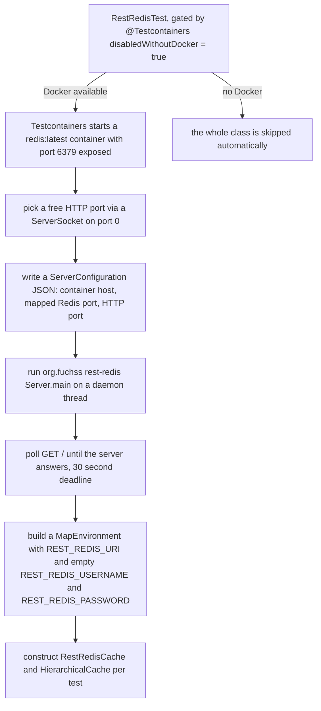

# Testing Strategy

`llm-access` is tested almost entirely **hermetically**: every test except one runs without a
server, without model credentials, and without Docker. Configuration is supplied
through an injected [`MapEnvironment`](../concepts/environment-provider.md), cache directories come
from JUnit's `@TempDir`, model calls come from recording or Mockito-stubbed test doubles, and only
`RestRedisTest` — the REST-Redis integration test — needs a real server topology, which it builds
itself and skips automatically when Docker is absent. (Two cache-manager tests deliberately aim a
`REDIS` cache at an unreachable `localhost:1` URL to prove the fail-fast connection contract;
that is still no real server.) Two ArchUnit rules
enforce the library's
no-global-environment invariant as part of the same run, and backward compatibility with LiSSA's
on-disk cache format is guarded by a checked-in fixture and a pinned key value. `mvn verify` is the
full gate (the CI wiring itself is covered in
[Operations and Deployment](../operations/deployment.md)).

## The boundary map

| Boundary | Test classes | Needs |
| --- | --- | --- |
| Cache unit | `CacheTest`, `CacheReplacementStrategyTest`, `CacheManagerTest` | `@TempDir`, `MapEnvironment` |
| Layer synchronization | `HierarchicalCacheTest` | Mockito mocks |
| Chat | `CachingChatModelTest`, `ChatModelUtilsTest`, `ChatModelProviderTest`, `ChatConfigurationTest`, `LazyChatModelTest` | recording/mocked `ChatModel`, `MapEnvironment` |
| Embedding | `CachedEmbeddingCreatorTest`, `EmbeddingConfigurationTest` | stub `EmbeddingModel`, `MapEnvironment` |
| Util | `KeyGeneratorTest`, `MapEnvironmentTest`, `SystemEnvironmentTest`, `FuturesTest` | `@TempDir` (for the `.env` tests) |
| Architecture | `NoGlobalEnvironmentTest` | ArchUnit over main classes |
| Integration | `RestRedisTest` | Docker (Testcontainers) |

The split is deliberate: everything that can be decided without a server is decided without one,
so the whole suite runs in seconds on any machine; only the code path that actually talks to a
REST-Redis deployment needs containers. The test libraries themselves (JUnit Jupiter, Mockito,
ArchUnit) come from the `io.github.ardoco:parent` POM; this project's
[`pom.xml`](../../pom.xml) adds the Testcontainers BOM (`2.0.5`) and the two Testcontainers
artifacts in test scope.

## Hermetic unit tests

Two building blocks make the hermetic tests possible:

- **`MapEnvironment`** — an immutable, in-memory [`EnvironmentProvider`](../concepts/environment-provider.md).
  Tests construct it with exactly the variables they need (for example
  `Map.of("CACHE_HIERARCHY", "LOCAL", "CACHE_REPLACEMENT_STRATEGY", "ERROR")`), so test outcomes
  never depend on the developer's system environment or `.env` file. `MapEnvironmentTest` pins the
  properties that make this safe: unknown keys return `null` with **no fallback to the system
  environment** (the test asserts even `PATH` is invisible), the map is defensively copied at
  construction, `toString()` lists the variable names but never the values (secrets stay out of
  logs), and equal maps yield equal, hash-equal environments.
- **`@TempDir`** — every cache lives in a per-test temporary directory, so no test ever reads or
  writes another test's cache files or the developer's real `cache/` directory.

### Test isolation: `CacheManager.setCacheDir` and `resetDefaultInstance`

The `CacheManager` default instance is process-global mutable state, and the suite isolates it
with a strict setup/teardown pattern:

```java
@BeforeEach
void setup() throws IOException {
    CacheManager.setCacheDir(tempCacheDir.toString(), environment);
}

@AfterEach
void teardown() {
    CacheManager.resetDefaultInstance();
}
```

All four manager-touching chat/cache suites (`CacheManagerTest`, `CacheTest`,
`CachingChatModelTest`, `ChatModelUtilsTest`) re-install the default instance in `@BeforeEach`;
`CacheManagerTest` and `CacheTest` additionally pair it with the `@AfterEach` teardown shown above.
Both mutators are `static synchronized`, and that synchronization is what makes the pattern safe:
the whole suite shares one JVM and one `defaultInstanceManager` field, so a test's `@BeforeEach`
install could otherwise interleave with another test's `@AfterEach` reset. The monitor on
`CacheManager.class` serializes the two mutators — `setCacheDir` atomically installs a **fresh**
manager (so cache memoization starts empty for each test) and `resetDefaultInstance` atomically
flushes the current default instance **before** nulling it, which persists dirty entries even if a
test forgot an explicit `flush()`. After a reset, `getDefaultInstance()` throws
`IllegalStateException` again until the next `setCacheDir`.

The second isolation style avoids the global instance entirely: `CachedEmbeddingCreatorTest`
constructs a standalone `new CacheManager(tempCacheDir, environment)` and passes it to the creators
it exercises, touching no static state at all. That is the same dependency-injection rule the
[architecture tests](#architecture-rules-noglobalenvironmenttest) enforce for production code.

### Cache unit tests

- **`CacheTest`** exercises `LocalCache` directly over a `@TempDir` file (its `MapEnvironment`
  pins `CACHE_HIERARCHY=LOCAL`, `CACHE_REPLACEMENT_STRATEGY=ERROR`): new entries land in the
  cache file after `flush()`, a freshly constructed instance reads them back, and arbitrary
  objects survive a Jackson round-trip. Its fourth test is the LiSSA backward-compatibility case
  described [below](#backward-compatibility-guardrails).
- **`CacheReplacementStrategyTest`** builds **two real `LocalCache` instances** (primary and
  secondary, each over its own `@TempDir` file) and pins the conflict semantics of
  [`CacheReplacementStrategy`](../cache/cache-hierarchy.md): `NONE` returns the primary value and
  leaves conflicting layers untouched while backfilling values missing on one side (in either
  direction, including deep-equal objects stored as distinct instances); `ERROR` throws
  `IllegalStateException` for a `deepEquals`-mismatched pair of non-null values but tolerates
  null-vs-non-null and identical content; `OVERWRITE` overwrites the secondary with the primary on
  conflict and otherwise backfills. The deprecated `resolveViaInternalKey` path is covered with
  the same expectations, so the internal-key resolution used by layer synchronization cannot drift
  from the string-key behavior.
- **`CacheManagerTest`** pins the manager itself: `getDefaultInstance` throws before a directory is
  set; `getCache` rejects `null` arguments, memoizes by name, and rejects the same name requested
  with non-equal parameters; colons in names are sanitized to `__` in file names; `flush()`
  persists to disk; the explicit constructor validates an empty hierarchy and a non-directory path;
  invalid `CACHE_HIERARCHY` / `CACHE_REPLACEMENT_STRATEGY` values from the injected environment
  throw `IllegalArgumentException` while unset variables fall back to the defaults. The
  `passesEnvironmentToRedisCache` test proves that connection settings come from the **injected**
  environment: a manager built with `REDIS_URL=redis://127.0.0.1:1` fails at the first `getCache`
  with a `JedisConnectionException` naming that URL — demonstrating both that no network I/O
  happens until `getCache` and that the injected value, not any global default, is used. (The same
  unreachable-port trick appears in `CachedEmbeddingCreatorTest.createUsesInjectedCacheManager`.)

### Layer synchronization with Mockito

`HierarchicalCacheTest` needs no real backend at all: both cache layers and the `CacheParameter`
are Mockito mocks (`@MockitoSettings(strictness = Strictness.LENIENT)`), and the tests construct
`HierarchicalCache` around them. The tests verify exactly the layer-synchronization contract —
`put` writes through to both the primary and the secondary layer, `containsKey` is true when
either layer holds the key and false when neither does, and `flush()` flushes both layers —
without a Redis or Docker instance. Conflict resolution is deliberately **not** tested here; that
responsibility belongs to `CacheReplacementStrategyTest` (unit-level, real files) and
`RestRedisTest` (end-to-end).

### Chat and embedding tests without model access

- **`CachingChatModelTest`** drives `CachingChatModel` with a `RecordingChatModel` that implements
  only `ChatModel.doChat(ChatRequest)` — the single method every `chat(...)` overload funnels
  through — and counts invocations. Each overload (string, message list, varargs, `ChatRequest`)
  is asserted to compute once and serve the repeat from cache, and a follow-up test re-creates the
  manager over the same `@TempDir` and asserts the cached response is served with **zero** further
  delegate calls.
- **`ChatModelUtilsTest`** does the same for `cachedRequest` / `nCachedRequest` with a Mockito
  `ChatModel`: `n` distinct model calls on the first n-fold request, cache-only on the second,
  persistence across a manager reload verified with `verifyNoInteractions`, and
  `IllegalArgumentException` for a non-positive count.
- **`ChatModelProviderTest`** and **`ChatConfigurationTest`** supply all credentials through
  `MapEnvironment` ("so the results do not depend on the developer's `.env` or system
  environment"). `createChatModel` is asserted to return a `LazyChatModel` — the platform client is
  never constructed in tests — and to throw `IllegalStateException` for **every** platform when the
  required credential is missing. `ChatConfigurationTest` additionally pins the default seed and
  temperature and the backward-compatible cache file identifier (`gpt-4o_133742243`).
- **`LazyChatModelTest`** verifies lazy initialization with a counting supplier (runs only on
  first use, exactly once) and a reflection check that `LazyChatModel` overrides every non-static
  `ChatModel` method, so the delegation coverage cannot silently rot when LangChain4j adds methods.
- **`CachedEmbeddingCreatorTest`** drives a recording subclass of `CachedEmbeddingCreator` whose
  `EmbeddingModel` is a Mockito stub counting `embed` calls and returning a deterministic vector
  derived from the first input character. It verifies single-computation caching, input-order
  preservation, the empty-input short-circuit (no model call), persistence across a cache reload,
  the parallel path's per-thread model construction with forwarded parameters, and that the
  environment injected into the constructor is visible inside `createEmbeddingModel`.
  `EmbeddingConfigurationTest` covers the configuration API (including that builders default to a
  fresh `SystemEnvironment` and that `MOCK` needs no model name) plus the mock creator's zero
  vectors — so embedding platform behavior is testable with no Ollama, OpenAI, or ONNX files.

## The Docker-gated integration test: `RestRedisTest`

`RestRedisTest` is the suite's single integration test and the only test that contacts a real
server. The class is annotated `@Testcontainers(disabledWithoutDocker = true)`, so `mvn verify`
skips it automatically in environments without Docker — the CI gate stays green everywhere, and
the test runs only where the topology it exercises can actually exist.



*The integration test assembles the deployed REST-Redis topology in-process: a real Redis container
behind the in-JVM REST-Redis `Server`, with connection settings injected through a `MapEnvironment`.*

Mechanics, per class lifecycle (`@TestInstance(TestInstance.Lifecycle.PER_CLASS)`):

1. **`@BeforeAll startServer`** — the `@Container` field starts a `redis:latest`
   `GenericContainer` with port 6379 exposed. The test picks a free HTTP port, serializes a
   `ServerConfiguration(container host, mapped Redis port, HTTP port)` to JSON in its own `@TempDir`,
   and starts `Server.main(...)` on a daemon thread — the in-JVM REST-Redis server from
   `org.fuchss:rest-redis` in front of the containerized Redis. It then polls `GET /` every 150 ms
   (any 2xx–5xx status counts as up) with a 30-second deadline, and finally builds the
   `MapEnvironment` carrying `REST_REDIS_URI`, and empty `REST_REDIS_USERNAME`/`REST_REDIS_PASSWORD`.
2. **`@BeforeEach`** — constructs a fresh `RestRedisCache` for a `ChatCacheParameter("test", 1, 0.0)`.
3. **`@AfterAll stopServer`** — closes the client, interrupts and joins the server thread (5 s),
   and shuts Unirest down, so no container-adjacent state leaks into other tests.

The tests cover the deployed topology end to end:

- **Connection** — `Cache.createByType(CacheType.REST_REDIS, ...)` succeeds against the running
  server (which also proves the fail-fast PING contract of
  [`RestRedisCache`](../cache/cache-backends.md) passes on a healthy backend).
- **Set/get** — `put` then `get` round-trips, and a missing key returns `null`.
- **`HierarchicalCache` over a local + REST-Redis pair** — all three
  [strategies](../cache/cache-hierarchy.md) against a real remote layer: `NONE` returns the local
  (primary) value and leaves the Redis value unchanged; `OVERWRITE` overwrites the Redis value with
  the local one after `flush()`; `ERROR` throws an `IllegalStateException` whose message contains
  "Cache inconsistency"; and a Redis-only value is backfilled into the local layer on `flush()`,
  which is exactly the write-down behavior a replication package relies on
  (see [Operations and Deployment](../operations/deployment.md)).

## Architecture rules: `NoGlobalEnvironmentTest`

`NoGlobalEnvironmentTest` is an ArchUnit suite over all non-test classes under
`edu.kit.kastel.mcse.ardoco.llm` (`@AnalyzeClasses(..., importOptions = ImportOption.DoNotIncludeTests.class)`).
It turns the [no-global-environment invariant](../architecture/overview.md) into build-enforced
rules rather than convention:

1. **`noStaticEnvironmentFields`**
   `noFields().that().areStatic().should().haveRawType(assignableTo(EnvironmentProvider.class))`
   — *because "environments must be injected, not shared globally"*. No static field anywhere in
   the library may hold an `EnvironmentProvider`, which forbids reintroducing a singleton like the
   removed legacy `Environment` class.
2. **`defaultCacheManagerOnlyInConvenienceOverload`**
   `noClasses().should().callMethodWhere(CALLS_DEFAULT_CACHE_MANAGER.and(not(IN_CONVENIENCE_OVERLOAD)))`
   — *because "the cache manager (and with it the cache environment) must be injected"*. The
   `CALLS_DEFAULT_CACHE_MANAGER` predicate matches any call whose target is
   `CacheManager.getDefaultInstance()`; the `IN_CONVENIENCE_OVERLOAD` predicate exempts exactly one
   origin: calls whose full name is
   `edu.kit.kastel.mcse.ardoco.llm.embedding.EmbeddingCreator.create(edu.kit.kastel.mcse.ardoco.llm.embedding.EmbeddingConfiguration)`.
   Every other class must take a `CacheManager` — and thereby its environment — as an injected
   dependency.

Together the rules mean a contributor cannot accidentally re-grow a global environment: the
compiler allows a static `EnvironmentProvider` field or a stray `getDefaultInstance()` call, but
`mvn verify` fails on it. The one sanctioned call site delegates to
`create(configuration, CacheManager.getDefaultInstance())` after short-circuiting the `MOCK`
platform, which needs no cache setup (see [Embeddings](../embeddings/embeddings.md)).

## Backward-compatibility guardrails

The cache file format is a **public artifact**: users ship `LOCAL` cache directories as
replication packages, and they originate from LiSSA's caches. Two tests hold the line:

- **`CacheTest.testBackwardCompatibility`** copies the checked-in fixture
  `src/test/resources/cache/test-local-cache-sample.json` — the LiSSA cache format, a flat JSON
  object mapping `KeyGenerator` content UUIDs to plain, unserialized string values — into the
  temp cache directory and reads all three entries back by their content strings
  (`test-key-1`…`test-key-3` → `test-value-1`…`test-value-3`). This exercises both halves of
  legacy readability at once: the content-UUID `localKey` derivation still addresses the old
  entries, and [`Cache.convert`](../cache/cache-core.md) returns a raw string when the legacy
  value is not JSON-encoded. Any change to key derivation or value encoding that breaks this test
  would orphan real users' caches.
- **`KeyGeneratorTest.stableUuidValue`** pins `KeyGenerator.generateKey("test")` to
  `098f6bcd-4621-3373-8ade-4e832627b4f6` with the comment that the value "must remain stable so
  existing cache files keep resolving" — the generated keys are part of the on-disk format, not an
  internal detail. The same test class pins the supporting properties: determinism, CRLF-to-LF
  normalization, distinct inputs to distinct keys, and `IllegalArgumentException` for `null`.

The file-identifier side of the format is pinned in the key tests as well:
`ChatCacheKeyTest` asserts that `ChatCacheParameter.parameters()` omits the temperature component
when it is `0.0` (`gpt-4o_42`) and includes it otherwise (`gpt-4o_42_0.5`), and
`EmbeddingCacheKeyTest.ofRawCustomLocalKey` guards the deprecated custom-local-key path used by
the long-text embedding recovery. The full story of these format decisions is in
[Cache Keys](../cache/cache-keys.md).

## Build, formatting, and CI gates

- **`mvn verify`** is the documented full check ([`README.md`](../../README.md), "Building"): the
  whole unit suite plus the Docker-gated integration test, which simply skips without Docker. In
  CI, [`.github/workflows/verify.yml`](../../.github/workflows/verify.yml) delegates to the shared
  `ardoco/actions/.github/workflows/maven.yml@main` workflow with `deploy: false`, submodules
  checked out, on `ubuntu-latest`; it triggers on pushes to `main` (ignoring `v*` tags) and on
  PRs, with `paths-ignore` for `docs/**` and `openwiki/**` so documentation-only changes do not
  trigger builds.
- **Formatting** is gated by Spotless, configured through the ardoco parent POM with the Eclipse
  profile in [`formatter.xml`](../../formatter.xml) and the import order in
  [`spotless.importorder`](../../spotless.importorder) (`java`, `javax`, `org`, `com`);
  `mvn spotless:apply` is the local command. The
  [`.github/workflows/format.yml`](../../.github/workflows/format.yml) bot runs on PRs to `main`
  (and manually): it derives the JDK version from the POM, runs `mvn -B spotless:apply --file pom.xml`,
  and auto-commits the result with `stefanzweifel/git-auto-commit-action` as
  "Apply formatting changes" — formatting differences never block a review, they are applied
  automatically.

## Running the tests

```sh
mvn verify                                                          # full gate; RestRedisTest skips without Docker
mvn -q test -Dtest=CacheTest                                        # local cache backend
mvn -q test -Dtest=CacheManagerTest,HierarchicalCacheTest,CacheReplacementStrategyTest
mvn -q test -Dtest=ChatModelProviderTest,ChatConfigurationTest,CachingChatModelTest,ChatModelUtilsTest
mvn -q test -Dtest=CachedEmbeddingCreatorTest,EmbeddingConfigurationTest
mvn -q test -Dtest=KeyGeneratorTest,MapEnvironmentTest,SystemEnvironmentTest,FuturesTest
mvn -q test -Dtest=NoGlobalEnvironmentTest                          # architecture rules
mvn -q test -Dtest=RestRedisTest                                    # requires Docker
```

## Where to read next

- [Architecture Overview](../architecture/overview.md) — the subsystem map the architecture tests
  protect.
- [Cache Hierarchy and Manager](../cache/cache-hierarchy.md) and
  [Cache Backends](../cache/cache-backends.md) — the behavior pinned by the cache tests, including
  the `UnifiedRedisClient` seam.
- [Cache Keys](../cache/cache-keys.md) — the key format the backward-compatibility guardrails pin.
- [Environment and Configuration](../concepts/environment-provider.md) — the seam the hermetic
  tests inject through.
- [Cached Chat Requests](../chat/cached-chat.md) and [Embeddings](../embeddings/embeddings.md) —
  the behaviors the chat and embedding test doubles exercise.
- [Operations and Deployment](../operations/deployment.md) — the CI workflows and the deployed
  topology the integration test mirrors.
