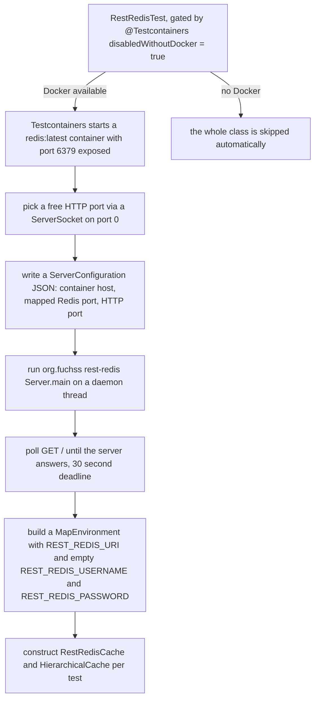

# Testing Strategy

`llm-access` is tested almost entirely **hermetically**: every test except two gated suites runs
without a server, without model credentials, and without Docker. Configuration is supplied
through an injected [`MapEnvironment`](../concepts/environment-provider.md), cache directories come
from JUnit's `@TempDir`, and model calls come from recording or Mockito-stubbed test doubles. Only
two suites need the outside world, and both gate themselves off when it is unavailable:
`RestRedisTest` — the REST-Redis integration test — builds its own server topology and skips
automatically when Docker is absent, and `BifrostIntegrationTest` — a live smoke test against a
real Bifrost gateway — is skipped unless `BIFROST_API_KEY` and `BIFROST_URL` are set. (Two tests
deliberately aim a `REDIS` hierarchy at an unreachable `localhost:1` URL to prove the fail-fast
connection contract; that is still no real server.) Two ArchUnit
suites run as part of the same build: `ArchitectureTest` structurally enforces cache-key
completeness, and `NoGlobalEnvironmentTest` enforces the library's
no-global-environment invariant. Backward compatibility with LiSSA's
on-disk cache format is guarded by a checked-in fixture, a pinned key value, and byte-stable
key-serialization pins. `mvn verify` is the full gate (the CI wiring itself is covered in
[Operations and Deployment](../operations/deployment.md)).

## The boundary map

| Boundary | Test classes | Needs |
| --- | --- | --- |
| Cache unit | `CacheTest`, `CacheReplacementStrategyTest`, `CacheManagerTest`, `CacheKeySerializationTest` | `@TempDir`, `MapEnvironment` |
| Layer synchronization | `HierarchicalCacheTest` | Mockito mocks |
| Chat | `CachingChatModelTest`, `ChatModelUtilsTest`, `ChatModelProviderTest`, `ChatConfigurationTest`, `LazyChatModelTest` | recording/mocked `ChatModel`, `MapEnvironment` |
| Embedding | `CachedEmbeddingCreatorTest`, `EmbeddingConfigurationTest` | stub `EmbeddingModel`, `MapEnvironment` |
| Util | `KeyGeneratorTest`, `MapEnvironmentTest`, `SystemEnvironmentTest`, `FuturesTest`, `BifrostTest` | `@TempDir` (for the `.env` tests), `MapEnvironment` |
| Architecture | `ArchitectureTest`, `NoGlobalEnvironmentTest` | ArchUnit over main classes |
| Integration (Docker-gated) | `RestRedisTest` | Docker (Testcontainers) |
| Integration (live-gated) | `BifrostIntegrationTest` | `BIFROST_API_KEY` and `BIFROST_URL` env vars |

The split is deliberate: everything that can be decided without a server is decided without one,
so the whole suite runs in seconds on any machine; only the code paths that actually talk to a
REST-Redis deployment or a Bifrost gateway are gated. The test libraries themselves: JUnit Jupiter
and Mockito come from the `io.github.ardoco:parent` POM, while this project's
[`pom.xml`](../../pom.xml) declares ArchUnit (`archunit-junit5`, 1.5.1), the Testcontainers BOM
(`2.0.5`) and the two Testcontainers artifacts (`testcontainers`, `testcontainers-junit-jupiter`)
in test scope. `org.fuchss:rest-redis` (0.1.7) is a compile dependency — which is exactly what
lets `RestRedisTest` run the real REST-Redis `Server` class in-process.

## Hermetic unit tests

Two building blocks make the hermetic tests possible:

- **`MapEnvironment`** — an immutable, in-memory [`EnvironmentProvider`](../concepts/environment-provider.md).
  Tests construct it with exactly the variables they need (for example
  `Map.of("CACHE_HIERARCHY", "LOCAL", "CACHE_REPLACEMENT_STRATEGY", "ERROR")`), so test outcomes
  never depend on the developer's system environment or `.env` file. `MapEnvironmentTest` pins the
  properties that make this safe: unknown keys return `null` with **no fallback to the system
  environment** (the test asserts even `PATH` is invisible), the map is defensively copied at
  construction, `toString()` lists the variable names but never the values (secrets stay out of
  logs), and equal maps yield equal, hash-equal environments.
- **`@TempDir`** — every cache lives in a per-test temporary directory, so no test ever reads or
  writes another test's cache files or the developer's real `cache/` directory.

### Test isolation: `CacheManager.setCacheDir` and `resetDefaultInstance`

The `CacheManager` default instance is process-global mutable state, and the suite isolates it
with a strict setup/teardown pattern:

```java
@BeforeEach
void setup() throws IOException {
    CacheManager.setCacheDir(tempCacheDir.toString(), environment);
}

@AfterEach
void teardown() {
    CacheManager.resetDefaultInstance();
}
```

All four manager-touching chat/cache suites (`CacheManagerTest`, `CacheTest`,
`CachingChatModelTest`, `ChatModelUtilsTest`) re-install the default instance in `@BeforeEach`;
`CacheManagerTest` and `CacheTest` additionally pair it with the `@AfterEach` teardown shown above.
Both mutators are `static synchronized`, and that synchronization is what makes the pattern safe:
the whole suite shares one JVM and one `defaultInstanceManager` field, so a test's `@BeforeEach`
install could otherwise interleave with another test's `@AfterEach` reset. The monitor on
`CacheManager.class` serializes the two mutators — `setCacheDir` atomically installs a **fresh**
manager (so cache memoization starts empty for each test) and `resetDefaultInstance` atomically
flushes the current default instance **before** nulling it, which persists dirty entries even if a
test forgot an explicit `flush()`. After a reset, `getDefaultInstance()` throws
`IllegalStateException` again until the next `setCacheDir`.

The second isolation style avoids the global instance entirely: `CachedEmbeddingCreatorTest`
constructs a standalone `new CacheManager(tempCacheDir, environment)` and passes it to the creators
it exercises, touching no static state at all. That is the same dependency-injection rule the
[architecture tests](#architecture-rules-noglobalenvironmenttest) enforce for production code.

### Cache unit tests

- **`CacheTest`** exercises `LocalCache` directly over a `@TempDir` file (its `MapEnvironment`
  pins `CACHE_HIERARCHY=LOCAL`, `CACHE_REPLACEMENT_STRATEGY=ERROR`): new entries land in the
  cache file after `flush()`, a freshly constructed instance reads them back, and arbitrary
  objects survive a Jackson round-trip. Its fourth test is the LiSSA backward-compatibility case
  described [below](#backward-compatibility-guardrails).
- **`CacheReplacementStrategyTest`** builds **two real `LocalCache` instances** (primary and
  secondary, each over its own `@TempDir` file) and pins the conflict semantics of
  [`CacheReplacementStrategy`](../cache/cache-hierarchy.md): `NONE` returns the primary value and
  leaves conflicting layers untouched while backfilling values missing on one side (in either
  direction, including deep-equal objects stored as distinct instances); `ERROR` throws
  `IllegalStateException` for a `deepEquals`-mismatched pair of non-null values but tolerates
  null-vs-non-null and identical content; `OVERWRITE` overwrites the secondary with the primary on
  conflict and otherwise backfills. The deprecated `resolveViaInternalKey` path is covered with
  the same expectations, so the internal-key resolution used by layer synchronization cannot drift
  from the string-key behavior.
- **`CacheManagerTest`** pins the manager itself: `getDefaultInstance` throws before a directory is
  set; `getCache` rejects `null` arguments, memoizes by name, and rejects the same name requested
  with non-equal parameters; file names are sanitized (colons in names become `__`, and forward and
  backward slashes — as in provider-prefixed model names like `openai/gpt-4o-mini` — become `--`,
  with no subdirectory ever created and a reloaded manager reading the entries back); `flush()`
  persists to disk; the explicit constructor validates an empty hierarchy and a non-directory path;
  invalid `CACHE_HIERARCHY` / `CACHE_REPLACEMENT_STRATEGY` values from the injected environment
  throw `IllegalArgumentException` while unset variables fall back to the defaults. The
  `passesEnvironmentToRedisCache` test proves that connection settings come from the **injected**
  environment: a manager built with `REDIS_URL=redis://127.0.0.1:1` fails at the first `getCache`
  with a `JedisConnectionException` naming that URL — demonstrating both that no network I/O
  happens until `getCache` and that the injected value, not any global default, is used. (The same
  unreachable-port trick appears in `CachedEmbeddingCreatorTest.createUsesInjectedCacheManager`.)
- **`CacheKeySerializationTest`** pins the exact serialized form of the cache keys, byte for byte
  (see [Backward-compatibility guardrails](#backward-compatibility-guardrails)).

### Layer synchronization with Mockito

`HierarchicalCacheTest` needs no real backend at all: both cache layers and the `CacheParameter`
are Mockito mocks (`@MockitoSettings(strictness = Strictness.LENIENT)`), and the tests construct
`HierarchicalCache` around them. The tests verify exactly the layer-synchronization contract —
`put` writes through to both the primary and the secondary layer, `containsKey` is true when
either layer holds the key and false when neither does, and `flush()` flushes both layers —
without a Redis or Docker instance. Conflict resolution is deliberately **not** tested here; that
responsibility belongs to `CacheReplacementStrategyTest` (unit-level, real files) and
`RestRedisTest` (end-to-end).

### Chat and embedding tests without model access

- **`CachingChatModelTest`** drives `CachingChatModel` with a `RecordingChatModel` that implements
  only `ChatModel.doChat(ChatRequest)` — the single method every `chat(...)` overload funnels
  through — and counts invocations. Each overload (string, message list, varargs, `ChatRequest`)
  is asserted to compute once and serve the repeat from cache, and a follow-up test re-creates the
  manager over the same `@TempDir` and asserts the cached response is served with **zero** further
  delegate calls.
- **`ChatModelUtilsTest`** does the same for `cachedRequest` / `nCachedRequest` with a Mockito
  `ChatModel`: `n` distinct model calls on the first n-fold request, cache-only on the second,
  persistence across a manager reload verified with `verifyNoInteractions`, and
  `IllegalArgumentException` for a non-positive count.
- **`ChatModelProviderTest`** and **`ChatConfigurationTest`** supply all credentials through
  `MapEnvironment` ("so the results do not depend on the developer's `.env` or system
  environment"). `createChatModel` is asserted to return a `LazyChatModel` — the platform client is
  never constructed in tests — and to throw `IllegalStateException` for **every** platform when the
  required credential is missing. `ChatConfigurationTest` additionally pins the default seed and
  temperature and the backward-compatible cache file identifier (`gpt-4o_133742243`).
- **`LazyChatModelTest`** verifies lazy initialization with a counting supplier (runs only on
  first use, exactly once, with a `NullPointerException` for a `null` supplier) and a reflection
  check that `LazyChatModel` overrides every non-static `ChatModel` method, so the delegation
  coverage cannot silently rot when LangChain4j adds methods.
- **`CachedEmbeddingCreatorTest`** drives a recording subclass of `CachedEmbeddingCreator` whose
  `EmbeddingModel` is a Mockito stub counting `embed` calls and returning a deterministic vector
  derived from the first input character. It verifies single-computation caching, input-order
  preservation, the empty-input short-circuit (no model call), persistence across a cache reload,
  the parallel path's per-thread model construction with forwarded parameters, and that the
  environment injected into the constructor is visible inside `createEmbeddingModel`. Beyond the
  recording stub, the class pins `EmbeddingCreator.create`'s per-platform fail-fast over
  `MapEnvironment`-only credentials (OpenAI needs `OPENAI_API_KEY`, Open WebUI its URL and key,
  Bifrost needs both `BIFROST_API_KEY` and `BIFROST_URL`) and the oversized-input handling for
  provider-prefixed models: a stub model rejects inputs over 45,000 characters, the creator
  truncates and retries, and the embedding resolves in exactly two model calls.
  `EmbeddingConfigurationTest` covers the configuration API (including that builders default to a
  fresh `SystemEnvironment` and that `MOCK` needs no model name) plus the mock creator's zero
  vectors — so embedding platform behavior is testable with no Ollama, OpenAI, or ONNX files.

## Architecture rules: `ArchitectureTest`

`ArchitectureTest` is an ArchUnit suite over all non-test classes under
`edu.kit.kastel.mcse.ardoco.llm` (`@AnalyzeClasses(..., importOptions = ImportOption.DoNotIncludeTests.class)`)
that guards the *correctness of the cache* rather than its wiring. Its premise: a configuration
attribute that is missing from a [`CacheKey`](../cache/cache-keys.md) or from
`CacheParameter.parameters()` makes different configurations share cache entries or cache files,
which silently returns wrong cached results. Two structural rules enforce completeness:

1. **`cacheKeysMustHaveOfMethodWithCacheParameter`**
   Every concrete `CacheKey` implementation must have a static `of(CacheParameter, String)` method,
   and the rule inspects each such factory's call graph: it must read **every** attribute of its
   `CacheParameter` type — every method except the explicitly exempted ones (`parameters()`,
   which generates the cache file name and is not used in key creation; `createCacheKey()`, which
   is the factory that calls `of()`, not the other way round; and `equals`/`hashCode`/`toString`).
   If an attribute (model name, seed, temperature, mode) is not read by `of()`, it is not part of
   the key, and entries created with different configurations would collide.
2. **`cacheParametersMustUseAllFieldsInParametersMethod`**
   Every concrete `CacheParameter` implementation must have a `parameters()` method that accesses
   every non-static field, either directly or through a record accessor. `parameters()` determines
   the cache file name, so a field missing there makes different configurations share one cache
   file.

Both rules fail the build with a message naming the class and the missed attribute (for example
*"Method X.of() does not read CacheParameter attribute 'seed'"*), so adding a field to a parameter
class without wiring it into both `parameters()` and `of()` cannot pass `mvn verify` — the
collision failure mode is prevented structurally instead of being caught by case-by-case key tests.

## Architecture rules: `NoGlobalEnvironmentTest`

`NoGlobalEnvironmentTest` is an ArchUnit suite over all non-test classes under
`edu.kit.kastel.mcse.ardoco.llm` (`@AnalyzeClasses(..., importOptions = ImportOption.DoNotIncludeTests.class)`).
It turns the [no-global-environment invariant](../architecture/overview.md) into build-enforced
rules rather than convention:

1. **`noStaticEnvironmentFields`**
   `noFields().that().areStatic().should().haveRawType(assignableTo(EnvironmentProvider.class))`
   — *because "environments must be injected, not shared globally"*. No static field anywhere in
   the library may hold an `EnvironmentProvider`, which forbids reintroducing a singleton like the
   removed legacy `Environment` class.
2. **`defaultCacheManagerOnlyInConvenienceOverload`**
   `noClasses().should().callMethodWhere(CALLS_DEFAULT_CACHE_MANAGER.and(not(IN_CONVENIENCE_OVERLOAD)))`
   — *because "the cache manager (and with it the cache environment) must be injected"*. The
   `CALLS_DEFAULT_CACHE_MANAGER` predicate matches any call whose target is
   `CacheManager.getDefaultInstance()`; the `IN_CONVENIENCE_OVERLOAD` predicate exempts exactly one
   origin: calls whose full name is
   `edu.kit.kastel.mcse.ardoco.llm.embedding.EmbeddingCreator.create(edu.kit.kastel.mcse.ardoco.llm.embedding.EmbeddingConfiguration)`.
   Every other class must take a `CacheManager` — and thereby its environment — as an injected
   dependency.

Together the rules mean a contributor cannot accidentally re-grow a global environment: the
compiler allows a static `EnvironmentProvider` field or a stray `getDefaultInstance()` call, but
`mvn verify` fails on it. The one sanctioned call site delegates to
`create(configuration, CacheManager.getDefaultInstance())` after short-circuiting the `MOCK`
platform, which needs no cache setup (see [Embeddings](../embeddings/embeddings.md)).

## The Docker-gated integration test: `RestRedisTest`

`RestRedisTest` is the suite's Docker-gated integration test and its only Testcontainers test. The
class is annotated `@Testcontainers(disabledWithoutDocker = true)`, so `mvn verify` skips it
automatically in environments without Docker — the CI gate stays green everywhere, and the test
runs only where the topology it exercises can actually exist.



*The integration test assembles the deployed REST-Redis topology in-process: a real Redis container
behind the in-JVM REST-Redis `Server`, with connection settings injected through a `MapEnvironment`.*

Mechanics, per class lifecycle (`@TestInstance(TestInstance.Lifecycle.PER_CLASS)`):

1. **`@BeforeAll startServer`** — the `@Container` field starts a `redis:latest`
   `GenericContainer` with port 6379 exposed. The test picks a free HTTP port, serializes a
   `ServerConfiguration(container host, mapped Redis port, HTTP port)` to JSON in its own `@TempDir`,
   and starts `Server.main(...)` on a daemon thread — the in-JVM REST-Redis server from
   `org.fuchss:rest-redis` in front of the containerized Redis. It then polls `GET /` every 150 ms
   (any 2xx–5xx status counts as up) with a 30-second deadline, and finally builds the
   `MapEnvironment` carrying `REST_REDIS_URI`, and empty `REST_REDIS_USERNAME`/`REST_REDIS_PASSWORD`.
2. **`@BeforeEach`** — constructs a fresh `RestRedisCache` for a `ChatCacheParameter("test", 1, 0.0)`.
3. **`@AfterAll stopServer`** — closes the client, interrupts and joins the server thread (5 s),
   and shuts Unirest down, so no container-adjacent state leaks into other tests.

The tests cover the deployed topology end to end:

- **Connection** — `Cache.createByType(CacheType.REST_REDIS, ...)` succeeds against the running
  server (which also proves the fail-fast PING contract of
  [`RestRedisCache`](../cache/cache-backends.md) passes on a healthy backend).
- **Set/get** — `put` then `get` round-trips, and a missing key returns `null`.
- **`HierarchicalCache` over a local + REST-Redis pair** — all three
  [strategies](../cache/cache-hierarchy.md) against a real remote layer: `NONE` returns the local
  (primary) value and leaves the Redis value unchanged; `OVERWRITE` overwrites the Redis value with
  the local one after `flush()`; `ERROR` throws an `IllegalStateException` whose message contains
  "Cache inconsistency"; and a Redis-only value is backfilled into the local layer on `flush()`,
  which is exactly the write-down behavior a replication package relies on
  (see [Operations and Deployment](../operations/deployment.md)).

## The live-gated Bifrost smoke test: `BifrostIntegrationTest`

`BifrostIntegrationTest` is the suite's only live test: it talks to a real Bifrost gateway and is
therefore gated on environment variables rather than Docker. `@EnabledIfEnvironmentVariable(named = "BIFROST_API_KEY", matches = ".+")`
and the same for `BIFROST_URL` mean the test is silently skipped everywhere those credentials are
absent — locally and in the default `mvn verify` run — and executes only where they are exported.
When enabled it reads credentials from a `SystemEnvironment` and makes two minimal requests:
`ChatModelProvider.createChatModel().chat("Reply with OK")` (model `openai/gpt-4o-mini`) must
return a non-blank answer, and `EmbeddingCreator.create(...).calculateEmbedding("hello world")`
(model `openai/text-embedding-3-small`, over a `@TempDir` `LOCAL`/`ERROR` cache manager) must
return a non-empty vector.

The [`bifrost.yml`](../../.github/workflows/bifrost.yml) workflow is what supplies those variables
in CI: it triggers on pushes to `main` and on PRs (with the same `paths-ignore` for `docs/**` and
`openwiki/**` as the other workflows, plus `workflow_dispatch`), and its job-level `if` —
`github.event.pull_request.head.repo.fork != true && github.actor != 'dependabot[bot]'` — skips
fork PRs, where secrets are unavailable, and carries over a `dependabot[bot]` actor check that is
a legacy holdover from when Dependabot opened the dependency PRs: dependency PRs now come from
Renovate (see [Operations and Deployment](../operations/deployment.md)), whose same-repository
branches are not forks and therefore still run this job. The job exports `BIFROST_API_KEY` and
`BIFROST_URL` from repository secrets and runs
`mvn -U -B -Dtest=BifrostIntegrationTest -Dsurefire.failIfNoSpecifiedTests=false test`
with the same POM-derived JDK and Maven 3.9.16 used by the shared verify workflow.

The Bifrost credential handling itself is pinned hermetically by `BifrostTest` in the util
package: `Bifrost.baseUrl` returns the configured `BIFROST_URL` and throws
`IllegalStateException` without one, `Bifrost.apiKey` requires `BIFROST_API_KEY`, and
`Bifrost.headers` wraps the key as the `x-bf-vk` header — all over `MapEnvironment`, no gateway
needed.

## Backward-compatibility guardrails

The cache file format is a **public artifact**: users ship `LOCAL` cache directories as
replication packages, and they originate from LiSSA's caches. Three kinds of tests hold the line:

- **`CacheTest.testBackwardCompatibility`** copies the checked-in fixture
  `src/test/resources/cache/test-local-cache-sample.json` — the LiSSA cache format, a single-line
  flat JSON object mapping `KeyGenerator` content UUIDs (`478af172-93d7-3e4e-87dc-4d7e36ce3d77`,
  `2f80bb0a-fd35-369d-ba09-af947f0de0cf`, `a77ed447-329b-3d78-9206-894fe61c39c4`) to plain,
  unserialized string values — into the temp cache directory and reads all three entries back by
  their content strings (`test-key-1`…`test-key-3` → `test-value-1`…`test-value-3`). This exercises
  both halves of legacy readability at once: the content-UUID `localKey` derivation still addresses
  the old entries, and [`Cache.convert`](../cache/cache-core.md) returns a raw string when the
  legacy value is not JSON-encoded. Any change to key derivation or value encoding that breaks
  this test would orphan real users' caches.
- **`CacheKeySerializationTest`** pins the Redis side of the format byte-for-byte: the JSON
  produced by `toJsonKey()` for both key types must match exact expected strings, including
  property order (`model`, `seed`, `temperature`, `mode`, `content`), two-space indentation, and
  the escaping of slashes, quotes, umlauts/emoji, control characters, and whitespace in the
  content. The test's comment states the reason: the JSON key addresses entries in Redis, so any
  change to the serialized form invalidates all existing caches.
- **`KeyGeneratorTest.stableUuidValue`** pins `KeyGenerator.generateKey("test")` to
  `098f6bcd-4621-3373-8ade-4e832627b4f6` with the comment that the value "must remain stable so
  existing cache files keep resolving" — the generated keys are part of the on-disk format, not an
  internal detail. The same test class pins the supporting properties: determinism, CRLF-to-LF
  normalization, distinct inputs to distinct keys, and `IllegalArgumentException` for `null`.

The file-identifier side of the format is pinned in the key tests as well:
`ChatCacheKeyTest` asserts that `ChatCacheParameter.parameters()` omits the temperature component
when it is `0.0` (`gpt-4o_42`) and includes it otherwise (`gpt-4o_42_0.5`), and
`EmbeddingCacheKeyTest.ofRawCustomLocalKey` guards the deprecated custom-local-key path used by
the long-text embedding recovery. The full story of these format decisions is in
[Cache Keys](../cache/cache-keys.md).

## Build, formatting, and CI gates

- **`mvn verify`** is the documented full check ([`README.md`](../../README.md), "Building"): the
  whole unit suite, both ArchUnit suites, and the Docker-gated integration test, which simply skips
  without Docker; `BifrostIntegrationTest` likewise skips without its credentials. In CI,
  [`.github/workflows/verify.yml`](../../.github/workflows/verify.yml) delegates to the shared
  `ardoco/actions/.github/workflows/maven.yml@main` workflow with `deploy: false`, submodules
  checked out, on `ubuntu-latest`; it triggers on pushes to `main` (ignoring `v*` tags) and on
  PRs, with `paths-ignore` for `docs/**` and `openwiki/**` so documentation-only changes do not
  trigger builds (and it can also be run manually via `workflow_dispatch`).
- **Bifrost integration** has its own workflow: [`.github/workflows/bifrost.yml`](../../.github/workflows/bifrost.yml)
  runs `BifrostIntegrationTest` against the real gateway on the same push/PR triggers, injecting
  the `BIFROST_API_KEY`/`BIFROST_URL` secrets (see above).
- **Formatting** is gated by Spotless, configured through the ardoco parent POM with the Eclipse
  profile in [`formatter.xml`](../../formatter.xml) and the import order in
  [`spotless.importorder`](../../spotless.importorder) (`java`, `javax`, `org`, `com`);
  `mvn spotless:apply` is the local command. The
  [`.github/workflows/format.yml`](../../.github/workflows/format.yml) bot runs on PRs to `main`
  (and manually via `workflow_dispatch`): it checks out the repo with `actions/checkout@v7`
  (submodules, full history), derives the JDK major version from the POM (`maven.compiler.target`
  → `maven.compiler.release` → `java.version`, stripping the legacy `1.` prefix and failing with
  a `::error` notice if no expression yields a number), installs it with `actions/setup-java@v6`
  (temurin distribution, Maven cache), runs `mvn -B spotless:apply --file pom.xml`, and
  auto-commits the result with `stefanzweifel/git-auto-commit-action@v7` as
  "Apply formatting changes" — formatting differences never block a review, they are applied
  automatically.

## Running the tests

```sh
mvn verify                                                          # full gate; RestRedisTest skips without Docker, BifrostIntegrationTest without credentials
mvn -q test -Dtest=CacheTest                                        # local cache backend
mvn -q test -Dtest=CacheManagerTest,HierarchicalCacheTest,CacheReplacementStrategyTest,CacheKeySerializationTest
mvn -q test -Dtest=ChatModelProviderTest,ChatConfigurationTest,CachingChatModelTest,ChatModelUtilsTest
mvn -q test -Dtest=CachedEmbeddingCreatorTest,EmbeddingConfigurationTest
mvn -q test -Dtest=KeyGeneratorTest,MapEnvironmentTest,SystemEnvironmentTest,FuturesTest,BifrostTest
mvn -q test -Dtest=ArchitectureTest,NoGlobalEnvironmentTest         # architecture rules
mvn -q test -Dtest=RestRedisTest                                    # requires Docker
BIFROST_API_KEY=... BIFROST_URL=... mvn -q test -Dtest=BifrostIntegrationTest   # requires a live gateway
```

## Where to read next

- [Architecture Overview](../architecture/overview.md) — the subsystem map the architecture tests
  protect.
- [Cache Hierarchy and Manager](../cache/cache-hierarchy.md) and
  [Cache Backends](../cache/cache-backends.md) — the behavior pinned by the cache tests, including
  the `UnifiedRedisClient` seam.
- [Cache Keys](../cache/cache-keys.md) — the key format the backward-compatibility guardrails and
  the `ArchitectureTest` completeness rules pin.
- [Environment and Configuration](../concepts/environment-provider.md) — the seam the hermetic
  tests inject through.
- [Cached Chat Requests](../chat/cached-chat.md) and [Embeddings](../embeddings/embeddings.md) —
  the behaviors the chat and embedding test doubles exercise.
- [Operations and Deployment](../operations/deployment.md) — the CI workflows and the deployed
  topology the integration test mirrors.
