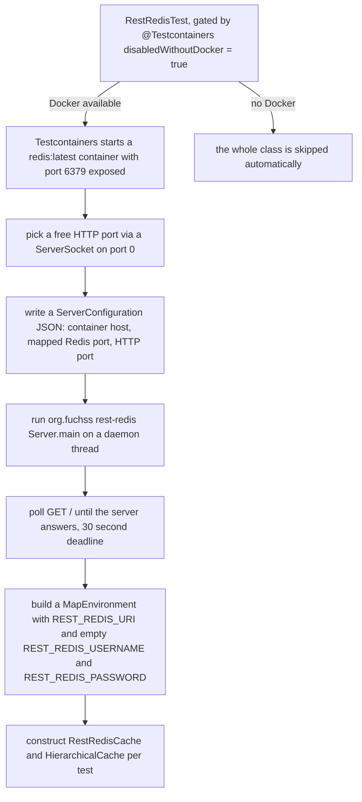
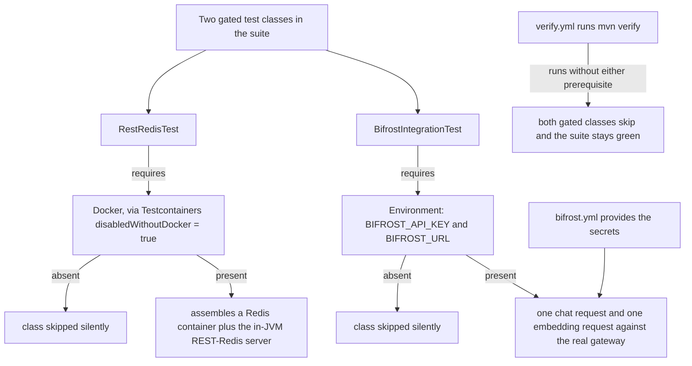

# Testing Strategy

`llm-access` is tested almost entirely **hermetically**: every test except two runs without a
server, without model credentials, and without Docker. Configuration is supplied
through an injected [`MapEnvironment`](../concepts/environment-provider.md), cache directories come
from JUnit's `@TempDir`, and model calls come from recording or Mockito-stubbed test doubles. Only
two classes break the hermetic seal, and each one gates itself: `RestRedisTest` — the REST-Redis
integration test — needs a real server topology, which it builds itself and skips automatically
when Docker is absent, while `BifrostIntegrationTest` — the live smoke test — needs real gateway
credentials (`BIFROST_API_KEY` and `BIFROST_URL`) and is silently skipped without them; a dedicated
`bifrost.yml` workflow is the only CI context in which it runs. (Two tests deliberately aim a
`REDIS` cache at an unreachable `localhost:1` URL to prove the fail-fast
connection contract; that is still no real server.) Two ArchUnit suites enforce the library's
no-global-environment invariant and the structural completeness of its cache keys as part of the
same run, and backward compatibility with LiSSA's
on-disk cache format is guarded by a checked-in fixture and a pinned key value. `mvn verify` is the
full gate (the CI wiring itself is covered in
[Operations and Deployment](../operations/deployment.md)).

## The boundary map

| Boundary | Test classes | Needs |
| --- | --- | --- |
| Cache unit | `CacheTest`, `CacheReplacementStrategyTest`, `CacheManagerTest` | `@TempDir`, `MapEnvironment` |
| Layer synchronization | `HierarchicalCacheTest` | Mockito mocks |
| Chat | `CachingChatModelTest`, `ChatModelUtilsTest`, `ChatModelProviderTest`, `ChatConfigurationTest`, `LazyChatModelTest` | recording/mocked `ChatModel`, `MapEnvironment` |
| Embedding | `CachedEmbeddingCreatorTest`, `EmbeddingConfigurationTest` | stub `EmbeddingModel`, `MapEnvironment` |
| Util | `KeyGeneratorTest`, `MapEnvironmentTest`, `SystemEnvironmentTest`, `FuturesTest`, `BifrostTest` | `@TempDir` (for the `.env` tests) |
| Architecture | `NoGlobalEnvironmentTest`, `ArchitectureTest` | ArchUnit over main classes |
| Integration (topology) | `RestRedisTest` | Docker (Testcontainers) |
| Integration (live gateway) | `BifrostIntegrationTest` | `BIFROST_API_KEY` and `BIFROST_URL` set in the environment |

The split is deliberate: everything that can be decided without a server or credentials is decided
without one, so the whole suite runs in seconds on any machine; only the code path that actually
talks to a REST-Redis deployment needs containers, and only the live Bifrost smoke test needs
credentials. The test libraries themselves (JUnit Jupiter, Mockito) come from the
`io.github.ardoco:parent` POM; this project's [`pom.xml`](../../pom.xml) adds the Testcontainers
BOM (`2.0.5`) with the two Testcontainers artifacts and `archunit-junit5` (`1.5.1`) — all in test
scope, all serving the gated integration or architecture tests.

## Hermetic unit tests

Two building blocks make the hermetic tests possible:

- **`MapEnvironment`** — an immutable, in-memory [`EnvironmentProvider`](../concepts/environment-provider.md).
  Tests construct it with exactly the variables they need (for example
  `Map.of("CACHE_HIERARCHY", "LOCAL", "CACHE_REPLACEMENT_STRATEGY", "ERROR")`), so test outcomes
  never depend on the developer's system environment or `.env` file. `MapEnvironmentTest` pins the
  properties that make this safe: unknown keys return `null` with **no fallback to the system
  environment** (the test asserts even `PATH` is invisible), the map is defensively copied at
  construction, `toString()` lists the variable names but never the values (secrets stay out of
  logs), and equal maps yield equal, hash-equal environments.
- **`@TempDir`** — every cache lives in a per-test temporary directory, so no test ever reads or
  writes another test's cache files or the developer's real `cache/` directory.

### Test isolation: `CacheManager.setCacheDir` and `resetDefaultInstance`

The `CacheManager` default instance is process-global mutable state, and the suite isolates it
with a strict setup/teardown pattern:

```java
@BeforeEach
void setup() throws IOException {
    CacheManager.setCacheDir(tempCacheDir.toString(), environment);
}

@AfterEach
void teardown() {
    CacheManager.resetDefaultInstance();
}
```

All four manager-touching chat/cache suites (`CacheManagerTest`, `CacheTest`,
`CachingChatModelTest`, `ChatModelUtilsTest`) re-install the default instance in `@BeforeEach`;
`CacheManagerTest` and `CacheTest` additionally pair it with the `@AfterEach` teardown shown above.
Both mutators are `static synchronized`, and that synchronization is what makes the pattern safe:
the whole suite shares one JVM and one `defaultInstanceManager` field, so a test's `@BeforeEach`
install could otherwise interleave with another test's `@AfterEach` reset. The monitor on
`CacheManager.class` serializes the two mutators — `setCacheDir` atomically installs a **fresh**
manager (so cache memoization starts empty for each test) and `resetDefaultInstance` atomically
flushes the current default instance **before** nulling it, which persists dirty entries even if a
test forgot an explicit `flush()`. After a reset, `getDefaultInstance()` throws
`IllegalStateException` again until the next `setCacheDir`.

The second isolation style avoids the global instance entirely: `CachedEmbeddingCreatorTest`
constructs a standalone `new CacheManager(tempCacheDir, environment)` and passes it to the creators
it exercises, touching no static state at all. That is the same dependency-injection rule the
[architecture tests](#architecture-rules-noglobalenvironmenttest-and-architecturetest) enforce for
production code.

### Cache unit tests

- **`CacheTest`** exercises `LocalCache` directly over a `@TempDir` file (its `MapEnvironment`
  pins `CACHE_HIERARCHY=LOCAL`, `CACHE_REPLACEMENT_STRATEGY=ERROR`): new entries land in the
  cache file after `flush()`, a freshly constructed instance reads them back, and arbitrary
  objects survive a Jackson round-trip. Its fourth test is the LiSSA backward-compatibility case
  described [below](#backward-compatibility-guardrails).
- **`CacheReplacementStrategyTest`** builds **two real `LocalCache` instances** (primary and
  secondary, each over its own `@TempDir` file) and pins the conflict semantics of
  [`CacheReplacementStrategy`](../cache/cache-hierarchy.md): `NONE` returns the primary value and
  leaves conflicting layers untouched while backfilling values missing on one side (in either
  direction, including deep-equal objects stored as distinct instances); `ERROR` throws
  `IllegalStateException` for a `deepEquals`-mismatched pair of non-null values but tolerates
  null-vs-non-null and identical content; `OVERWRITE` overwrites the secondary with the primary on
  conflict and otherwise backfills. The deprecated `resolveViaInternalKey` path is covered with
  the same expectations, so the internal-key resolution used by layer synchronization cannot drift
  from the string-key behavior.
- **`CacheManagerTest`** pins the manager itself: `getDefaultInstance` throws before a directory is
  set; `getCache` rejects `null` arguments, memoizes by name, and rejects the same name requested
  with non-equal parameters; file names are sanitized so that colons become `__` and forward or
  backward slashes become `--` (so provider-prefixed model names such as `openai/gpt-4o-mini`
  produce flat files in the cache directory — the test flushes, checks no subdirectory was
  created, and round-trips the values through a reloaded manager); `flush()` persists to disk; the
  explicit constructor validates an empty hierarchy and a non-directory path; invalid
  `CACHE_HIERARCHY` / `CACHE_REPLACEMENT_STRATEGY` values from the injected environment throw
  `IllegalArgumentException` while unset variables fall back to the defaults. The
  `passesEnvironmentToRedisCache` test proves that connection settings come from the **injected**
  environment: a manager built with `REDIS_URL=redis://127.0.0.1:1` fails at the first `getCache`
  with a `JedisConnectionException` naming that URL — demonstrating both that no network I/O
  happens until `getCache` and that the injected value, not any global default, is used. (The same
  unreachable-port trick appears in `CachedEmbeddingCreatorTest.createUsesInjectedCacheManager`.)

### Layer synchronization with Mockito

`HierarchicalCacheTest` needs no real backend at all: both cache layers and the `CacheParameter`
are Mockito mocks (`@MockitoSettings(strictness = Strictness.LENIENT)`), and the tests construct
`HierarchicalCache` around them. The tests verify exactly the layer-synchronization contract —
`put` writes through to both the primary and the secondary layer, `containsKey` is true when
either layer holds the key and false when neither does, and `flush()` flushes both layers —
without a Redis or Docker instance. Conflict resolution is deliberately **not** tested here; that
responsibility belongs to `CacheReplacementStrategyTest` (unit-level, real files) and
`RestRedisTest` (end-to-end).

### Chat and embedding tests without model access

- **`CachingChatModelTest`** drives `CachingChatModel` with a `RecordingChatModel` that implements
  only `ChatModel.doChat(ChatRequest)` — the single method every `chat(...)` overload funnels
  through — and counts invocations. Each overload (string, message list, varargs, `ChatRequest`)
  is asserted to compute once and serve the repeat from cache, and a follow-up test re-creates the
  manager over the same `@TempDir` and asserts the cached response is served with **zero** further
  delegate calls.
- **`ChatModelUtilsTest`** does the same for `cachedRequest` / `nCachedRequest` with a Mockito
  `ChatModel`: `n` distinct model calls on the first n-fold request, cache-only on the second,
  persistence across a manager reload verified with `verifyNoInteractions`, and
  `IllegalArgumentException` for a non-positive count.
- **`ChatModelProviderTest`** and **`ChatConfigurationTest`** supply all credentials through
  `MapEnvironment` ("so the results do not depend on the developer's `.env` or system
  environment"). `createChatModel` is asserted to return a `LazyChatModel` — the platform client is
  never constructed in tests — both for OpenAI (key and organization set) and for Bifrost (key and
  URL set). It throws `IllegalStateException` for **every** platform when the required credential
  is missing: the test loops over all six `ChatModelPlatform` values with an empty environment, and
  Bifrost additionally fails fast when only the key **or** only the URL is set. A final test
  proves credentials are read from the **injected** environment only — an environment carrying
  `OLLAMA_HOST` builds an Ollama model but cannot open an OpenAI one. `ChatConfigurationTest`
  also pins the default seed and temperature and the backward-compatible cache file identifier
  (`gpt-4o_133742243`).
- **`LazyChatModelTest`** verifies lazy initialization with a counting supplier (runs only on
  first use, exactly once) and a reflection check that `LazyChatModel` overrides every non-static
  `ChatModel` method, so the delegation coverage cannot silently rot when LangChain4j adds methods.
- **`CachedEmbeddingCreatorTest`** drives a recording subclass of `CachedEmbeddingCreator` whose
  `EmbeddingModel` is a Mockito stub counting `embed` calls and returning a deterministic vector
  derived from the first input character. It verifies single-computation caching, input-order
  preservation, the empty-input short-circuit (no model call), persistence across a cache reload,
  the parallel path's per-thread model construction with forwarded parameters, and that the
  environment injected into the constructor is visible inside `createEmbeddingModel`. It also
  covers the `EmbeddingCreator.create` factory paths — OpenAI and Bifrost fail fast without
  credentials and yield `OpenAiEmbeddingCreator` / `BifrostEmbeddingCreator` when present, the
  cache settings of the injected manager are used, and an oversized input for a provider-prefixed
  model (`openai/text-embedding-3-small`) is truncated and retried. **`EmbeddingConfigurationTest`**
  covers the configuration API: builders require a model name except for the `MOCK` platform,
  default to a fresh `SystemEnvironment`, `fromString` resolves platforms case-insensitively
  (including `bifrost`), ONNX requires both file paths, and the mock creator returns zero vectors —
  so embedding platform behavior is testable with no Ollama, OpenAI, ONNX, or gateway access.

## The Docker-gated integration test: `RestRedisTest`

`RestRedisTest` is the suite's single **topology** integration test and the only test that
contacts a real server of its own making. The class is annotated
`@Testcontainers(disabledWithoutDocker = true)`, so `mvn verify` skips it automatically in
environments without Docker — the CI gate stays green everywhere, and the test runs only where the
topology it exercises can actually exist.



*The integration test assembles the deployed REST-Redis topology in-process: a real Redis container
behind the in-JVM REST-Redis `Server`, with connection settings injected through a `MapEnvironment`.*

Mechanics, per class lifecycle (`@TestInstance(TestInstance.Lifecycle.PER_CLASS)`):

1. **`@BeforeAll startServer`** — the `@Container` field starts a `redis:latest`
   `GenericContainer` with port 6379 exposed. The test picks a free HTTP port, serializes a
   `ServerConfiguration(container host, mapped Redis port, HTTP port)` to JSON in its own `@TempDir`,
   and starts `Server.main(...)` on a daemon thread — the in-JVM REST-Redis server from
   `org.fuchss:rest-redis` in front of the containerized Redis. It then polls `GET /` every 150 ms
   (any 2xx–5xx status counts as up) with a 30-second deadline, and finally builds the
   `MapEnvironment` carrying `REST_REDIS_URI`, and empty `REST_REDIS_USERNAME`/`REST_REDIS_PASSWORD`.
2. **`@BeforeEach`** — constructs a fresh `RestRedisCache` for a `ChatCacheParameter("test", 1, 0.0)`.
3. **`@AfterAll stopServer`** — closes the client, interrupts and joins the server thread (5 s),
   and shuts Unirest down, so no container-adjacent state leaks into other tests.

The tests cover the deployed topology end to end:

- **Connection** — `Cache.createByType(CacheType.REST_REDIS, ...)` succeeds against the running
  server (which also proves the fail-fast PING contract of
  [`RestRedisCache`](../cache/cache-backends.md) passes on a healthy backend).
- **Set/get** — `put` then `get` round-trips, and a missing key returns `null`.
- **`HierarchicalCache` over a local + REST-Redis pair** — all three
  [strategies](../cache/cache-hierarchy.md) against a real remote layer: `NONE` returns the local
  (primary) value and leaves the Redis value unchanged; `OVERWRITE` overwrites the Redis value with
  the local one after `flush()`; `ERROR` throws an `IllegalStateException` whose message contains
  "Cache inconsistency"; and a Redis-only value is backfilled into the local layer on `flush()`,
  which is exactly the write-down behavior a replication package relies on
  (see [Operations and Deployment](../operations/deployment.md)).

## The credential-gated live smoke test: `BifrostIntegrationTest`

`BifrostIntegrationTest` is the suite's second gated test and its only contact with a real model
backend. Where `RestRedisTest` builds its own topology in-process, this test deliberately does the
opposite: it talks to whatever real Bifrost gateway the environment points at, so it is gated on
**credentials**, not Docker:

```java
@EnabledIfEnvironmentVariable(named = "BIFROST_API_KEY", matches = ".+")
@EnabledIfEnvironmentVariable(named = "BIFROST_URL", matches = ".+")
```

Without both variables the whole class is silently skipped, so `mvn verify` stays green on machines
without a gateway. Because the point is to exercise real wiring, this test reads the **real**
environment (`SystemEnvironment`) rather than a `MapEnvironment` — the only test in the suite that
does.

It makes exactly two requests, one per subsystem:

- **`chat`** — builds an `LlmConfiguration` for `ChatModelPlatform.BIFROST` with the
  provider-prefixed model `openai/gpt-4o-mini` and asserts that
  `createChatModel().chat("Reply with OK")` returns a non-blank string.
- **`embedding`** — builds an `EmbeddingConfiguration` for `EmbeddingPlatform.BIFROST` with model
  `openai/text-embedding-3-small`, a `@TempDir` `CacheManager` pinned to
  `CACHE_HIERARCHY=LOCAL` / `CACHE_REPLACEMENT_STRATEGY=ERROR`, and asserts that
  `EmbeddingCreator.create(configuration, cacheManager).calculateEmbedding("hello world")`
  returns a non-empty vector.

Each request therefore exercises the full live path the hermetic tests stub out: lazy chat-model
construction against the gateway, provider-prefixed model naming, `x-bf-vk` authentication, and the
first real cache write.



*Both gated tests skip silently without their prerequisite — Docker for `RestRedisTest`, real
gateway credentials for `BifrostIntegrationTest` — which is what keeps `mvn verify` green
everywhere; the `bifrost.yml` workflow is the only CI context in which the live requests actually
execute.*

CI runs the smoke test through a dedicated workflow,
[`.github/workflows/bifrost.yml`](../../.github/workflows/bifrost.yml) ("Bifrost Integration"),
described under [the CI gates](#build-formatting-and-ci-gates) below. The hermetic half of the
Bifrost contract is covered separately by `BifrostTest` (util row in the boundary map), which pins
that `Bifrost.baseUrl` returns the configured `BIFROST_URL`, that a missing URL or API key throws
`IllegalStateException`, and that the API key travels as the `x-bf-vk` header (see
[Bifrost Gateway Integration](../integrations/bifrost-gateway.md)).

## Architecture rules: `NoGlobalEnvironmentTest` and `ArchitectureTest`

Two ArchUnit suites run in the same `mvn verify` and turn the library's invariants into
build-enforced rules rather than convention. `NoGlobalEnvironmentTest` guards the
[no-global-environment invariant](../architecture/overview.md); `ArchitectureTest` guards the
completeness of the cache keys.

### `NoGlobalEnvironmentTest`

`NoGlobalEnvironmentTest` is an ArchUnit suite over all non-test classes under
`edu.kit.kastel.mcse.ardoco.llm` (`@AnalyzeClasses(..., importOptions = ImportOption.DoNotIncludeTests.class)`).
It makes the no-global-environment invariant build-enforced:

1. **`noStaticEnvironmentFields`**
   `noFields().that().areStatic().should().haveRawType(assignableTo(EnvironmentProvider.class))`
   — *because "environments must be injected, not shared globally"*. No static field anywhere in
   the library may hold an `EnvironmentProvider`, which forbids reintroducing a singleton like the
   removed legacy `Environment` class.
2. **`defaultCacheManagerOnlyInConvenienceOverload`**
   `noClasses().should().callMethodWhere(CALLS_DEFAULT_CACHE_MANAGER.and(not(IN_CONVENIENCE_OVERLOAD)))`
   — *because "the cache manager (and with it the cache environment) must be injected"*. The
   `CALLS_DEFAULT_CACHE_MANAGER` predicate matches any call whose target is
   `CacheManager.getDefaultInstance()`; the `IN_CONVENIENCE_OVERLOAD` predicate exempts exactly one
   origin: calls whose full name is
   `edu.kit.kastel.mcse.ardoco.llm.embedding.EmbeddingCreator.create(edu.kit.kastel.mcse.ardoco.llm.embedding.EmbeddingConfiguration)`.
   Every other class must take a `CacheManager` — and thereby its environment — as an injected
   dependency.

Together the rules mean a contributor cannot accidentally re-grow a global environment: the
compiler allows a static `EnvironmentProvider` field or a stray `getDefaultInstance()` call, but
`mvn verify` fails on it. The one sanctioned call site delegates to
`create(configuration, CacheManager.getDefaultInstance())` after short-circuiting the `MOCK`
platform, which needs no cache setup (see [Embeddings](../embeddings/embeddings.md)).

### Cache-key completeness: `ArchitectureTest`

`ArchitectureTest` is the second ArchUnit suite, with the same analysis scope
(`@AnalyzeClasses(packages = "edu.kit.kastel.mcse.ardoco.llm", importOptions = ImportOption.DoNotIncludeTests.class)`).
Its target is not dependency direction but a **correctness invariant of the cache keys**, spelled
out in its javadoc: a configuration attribute that is missing from a `CacheKey` or from
`CacheParameter.parameters()` makes different configurations share cache entries or cache files,
silently returning wrong cached results. Nothing in the type system catches that, so the suite
turns it into two structural rules over the main sources:

1. **`cacheKeysMustHaveOfMethodWithCacheParameter`** — every non-interface `CacheKey`
   implementation must declare a `static of(CacheParameter, String)` factory, and the factory must
   *read every attribute* of the `CacheParameter` it receives. The check collects the
   `CacheParameter`'s methods — excluding `parameters()` (which generates the cache file name and
   is not used in key creation), `createCacheKey()` (the factory that calls `of()`, not the other
   way round), and the `Object` methods `equals`/`hashCode`/`toString` — and fails if any of those
   names is absent from the calls made inside `of(...)`. If an attribute (model name, seed,
   temperature, …) is never read, it is not part of the entry key, and entries created with
   different configurations collide and return wrong cached results.
2. **`cacheParametersMustUseAllFieldsInParametersMethod`** — every `CacheParameter` implementation
   must have a `parameters()` method that accesses **all** of its non-static fields, whether by
   direct field access or through record-style accessor calls. `parameters()` determines the cache
   **file name**, so a field missing there makes different configurations share one cache file and
   silently return wrong cached results.

Together the two rules cover both halves of cache identity: `of(...)` decides *which entry inside
the file*, `parameters()` decides *which file*. The rules analyze main sources only, so they bind
the production implementations (`ChatCacheKey`/`ChatCacheParameter` and
`EmbeddingCacheKey`/`EmbeddingCacheParameter`) without dragging test fixtures into the contract.

## Backward-compatibility guardrails

The cache file format is a **public artifact**: users ship `LOCAL` cache directories as
replication packages, and they originate from LiSSA's caches. Two tests hold the line:

- **`CacheTest.testBackwardCompatibility`** copies the checked-in fixture
  `src/test/resources/cache/test-local-cache-sample.json` — the LiSSA cache format, a flat JSON
  object mapping `KeyGenerator` content UUIDs to plain, unserialized string values — into the
  temp cache directory and reads all three entries back by their content strings
  (`test-key-1`…`test-key-3` → `test-value-1`…`test-value-3`). This exercises both halves of
  legacy readability at once: the content-UUID `localKey` derivation still addresses the old
  entries, and [`Cache.convert`](../cache/cache-core.md) returns a raw string when the legacy
  value is not JSON-encoded. Any change to key derivation or value encoding that breaks this test
  would orphan real users' caches.
- **`KeyGeneratorTest.stableUuidValue`** pins `KeyGenerator.generateKey("test")` to
  `098f6bcd-4621-3373-8ade-4e832627b4f6` with the comment that the value "must remain stable so
  existing cache files keep resolving" — the generated keys are part of the on-disk format, not an
  internal detail. The same test class pins the supporting properties: determinism, CRLF-to-LF
  normalization, distinct inputs to distinct keys, and `IllegalArgumentException` for `null`.

The file-identifier side of the format is pinned in the key tests as well:
`ChatCacheKeyTest` asserts that `ChatCacheParameter.parameters()` omits the temperature component
when it is `0.0` (`gpt-4o_42`) and includes it otherwise (`gpt-4o_42_0.5`), and
`EmbeddingCacheKeyTest.ofRawCustomLocalKey` guards the deprecated custom-local-key path used by
the long-text embedding recovery. The full story of these format decisions is in
[Cache Keys](../cache/cache-keys.md).

## Build, formatting, and CI gates

- **`mvn verify`** is the documented full check ([`README.md`](../../README.md), "Building"): the
  whole unit suite plus the Docker-gated integration test, which simply skips without Docker (the
  credential-gated `BifrostIntegrationTest` skips the same way without credentials). In CI,
  [`.github/workflows/verify.yml`](../../.github/workflows/verify.yml) delegates to the shared
  `ardoco/actions/.github/workflows/maven.yml@main` workflow with `deploy: false`, submodules
  checked out, on `ubuntu-latest`; it triggers on pushes to `main` (ignoring `v*` tags) and on
  PRs, with `paths-ignore` for `docs/**` and `openwiki/**` so documentation-only changes do not
  trigger builds (and it can also be run manually via `workflow_dispatch`).
- **Bifrost smoke** — [`.github/workflows/bifrost.yml`](../../.github/workflows/bifrost.yml)
  ("Bifrost Integration") is the only CI context in which `BifrostIntegrationTest` runs. It
  triggers on pushes to `main` (ignoring `v*` tags), on PRs, and via `workflow_dispatch`, with the
  same `paths-ignore` for `docs/**` and `openwiki/**`. The job is skipped for forks and Dependabot
  (`github.event.pull_request.head.repo.fork != true && github.actor != 'dependabot[bot]'`)
  because secrets are unavailable there and there would be nothing to test against. Its steps
  mirror the other workflows: checkout with submodules, the same POM-driven JDK version derivation
  (`maven.compiler.target` → `maven.compiler.release` → `java.version`, stripping the legacy `1.`
  prefix, `::error` notice on failure) with `actions/setup-java@v6` (temurin, Maven cache), a
  pinned Maven `3.9.16` (the same version the shared ardoco workflow uses), and then
  `mvn -U -B -Dtest=BifrostIntegrationTest -Dsurefire.failIfNoSpecifiedTests=false test` with
  `BIFROST_API_KEY` and `BIFROST_URL` injected from GitHub secrets.
- **Formatting** is gated by Spotless, configured through the ardoco parent POM with the Eclipse
  profile in [`formatter.xml`](../../formatter.xml) and the import order in
  [`spotless.importorder`](../../spotless.importorder) (`java`, `javax`, `org`, `com`);
  `mvn spotless:apply` is the local command. The
  [`.github/workflows/format.yml`](../../.github/workflows/format.yml) bot runs on PRs to `main`
  (and manually via `workflow_dispatch`): it checks out the repo with `actions/checkout@v7`
  (submodules, full history), derives the JDK major version from the POM (`maven.compiler.target`
  → `maven.compiler.release` → `java.version`, stripping the legacy `1.` prefix and failing with
  a `::error` notice if no expression yields a number), installs it with `actions/setup-java@v6`
  (temurin distribution, Maven cache), runs `mvn -B spotless:apply --file pom.xml`, and
  auto-commits the result with `stefanzweifel/git-auto-commit-action@v7` as
  "Apply formatting changes" — formatting differences never block a review, they are applied
  automatically.

## Running the tests

```sh
mvn verify                                                          # full gate; RestRedisTest skips without Docker, BifrostIntegrationTest without credentials
mvn -q test -Dtest=CacheTest                                        # local cache backend
mvn -q test -Dtest=CacheManagerTest,HierarchicalCacheTest,CacheReplacementStrategyTest
mvn -q test -Dtest=ChatModelProviderTest,ChatConfigurationTest,CachingChatModelTest,ChatModelUtilsTest
mvn -q test -Dtest=CachedEmbeddingCreatorTest,EmbeddingConfigurationTest
mvn -q test -Dtest=KeyGeneratorTest,MapEnvironmentTest,SystemEnvironmentTest,FuturesTest,BifrostTest
mvn -q test -Dtest=NoGlobalEnvironmentTest,ArchitectureTest         # architecture rules
mvn -q test -Dtest=RestRedisTest                                    # requires Docker
BIFROST_API_KEY=... BIFROST_URL=... mvn -q test -Dtest=BifrostIntegrationTest   # requires a reachable gateway
```

## Where to read next

- [Architecture Overview](../architecture/overview.md) — the subsystem map the architecture tests
  protect.
- [Cache Hierarchy and Manager](../cache/cache-hierarchy.md) and
  [Cache Backends](../cache/cache-backends.md) — the behavior pinned by the cache tests, including
  the `UnifiedRedisClient` seam.
- [Cache Keys](../cache/cache-keys.md) — the key format the backward-compatibility guardrails and
  the cache-key completeness rules pin.
- [Environment and Configuration](../concepts/environment-provider.md) — the seam the hermetic
  tests inject through.
- [Cached Chat Requests](../chat/cached-chat.md) and [Embeddings](../embeddings/embeddings.md) —
  the behaviors the chat and embedding test doubles exercise.
- [Bifrost Gateway Integration](../integrations/bifrost-gateway.md) — the live gateway behind the
  credential-gated smoke test and its settings contract.
- [Operations and Deployment](../operations/deployment.md) — the CI workflows and the deployed
  topology the integration test mirrors.
